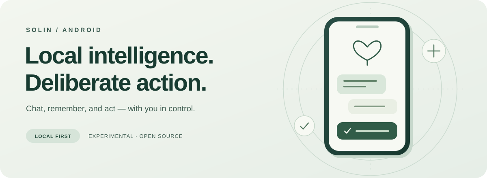
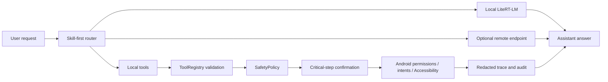

# 栖知 Solin

**A privacy-first Android assistant for local chat, memory, and guarded phone actions.**

[](https://github.com/William-zgx/solin-android/actions/workflows/android.yml)
[](#quick-start)
[](#license)
[](#current-status)

English · [简体中文](README.zh-CN.md)

[Quick start](#quick-start) · [Phone control](#phone-control-scope) · [Privacy](#product-contract) · [Documentation](#documentation) · [Contributing](#contributing)

<p align="center">
  
</p>

*Concept illustration, not an app screenshot.*

Solin runs LiteRT-LM chat on your phone, keeps memory local, and combines tools
with an observe–act loop. An OpenAI-compatible remote endpoint is optional.
Permission, privacy, and live action checks determine what can run; critical
controls stay in your hands.

## Product Contract

- **Local by default.** Chat history, memory, private tool results, screen text,
  OCR, and local attachments stay on device unless the user chooses an authorized
  remote path. Unknown privacy metadata fails closed as `LocalOnly`.
- **Remote is optional.** Remote chat needs a configured endpoint and Remote
  mode. Images, suspected sensitive text, and other configured remote sends
  require preview or confirmation.
- **Only critical actions are confirmed.** Permitted reversible actions can
  run directly. External sends, unknown tools, model-flagged sensitive steps,
  sensitive network queries, or queries after a private read require confirmation.
  After a private read, typing words the user did not supply also asks. Sensitive
  or newly composed text handed to another app is checked too; a draft made only
  from the user's words can be auto-approved when it is non-sensitive and triggers
  no other critical rule.
- **Critical controls stay with the user.** The agent does not tap pay, send,
  delete, publish, order, transfer, or authorize controls; those are
  always tapped by the user. A Trust-Center option restores per-step
  confirmation for ordinary actions.
- **Remote vision requires approval.** The opt-in, Remote mode, a vision-capable
  model, and the run's first user-confirmed in-app step are required before screen
  egress, in both confirmation modes. Each send is audited without raw prompts.
- **Users stay in control.** Keys, conversations, and memory can be cleared.
  A lost permission, unsupported model, or invalid result cannot silently enable
  another data path.



The [privacy notice](docs/privacy_notice.md) owns the complete data and consent
rules. The optional cloud router is a separate opt-in: eligible request text may
be sent to the configured decision model in Shadow or Active mode; it is not a
purely local policy. See [Auto status](docs/specs/20260718-adaptive-edge-inference/status.md).

## Implementation Highlights

| Capability | What is available |
| --- | --- |
| Local chat and images | Verified E2B/E4B Text+Vision models, GPU/CPU fallback, bounded image input |
| Local memory | Lightweight local index; semantic recall after the embedding runtime probe passes |
| Phone tools | Reminders, drafts, navigation, screen text, OCR, contacts, calendar, and low-risk app search |
| Reliable phone operations | Input readback, bounded stability checks, collection, target lookup, and NumberPicker adjustment |
| Route reuse | Verified short search routes reused within the same session and request; every step is authorized again |
| Optional remote inference | OpenAI-compatible chat, explicit remote-vision automation, and optional cloud routing |
| Background-display experiment | Debug-only, explicitly provisioned independent display; compatible Android 14+ required for independent app focus |

Solin is **experimental**, intended for local development and personal evaluation.
It is not ready for broad app-store distribution. [Current limitations](#current-status)
and [release readiness](docs/release_readiness.md) distinguish implemented behavior
from verified device support and release approval.

The chat surface only shows a safe result summary; structured tool fields stay
available through the trace/audit surfaces, not a typed chat card.

## Quick Start

Use **JDK 21** to match CI. Install Android SDK platform 36, build-tools 36.0.0,
and platform-tools. Compile/target SDK is 36, minimum Android API is 28, and the
current native build targets arm64-v8a. Java/Kotlin output targets Java 17;
`doctor.sh` checks a minimum JDK of 17.

```bash
git clone https://github.com/William-zgx/solin-android.git
cd solin-android
export ANDROID_HOME=/path/to/android-sdk
export ANDROID_SDK_ROOT="$ANDROID_HOME"
scripts/doctor.sh
./gradlew :app:assembleDebug
adb install -r app/build/outputs/apk/debug/app-debug.apk
```

Use a compatible physical Android device for realistic LiteRT-LM validation.
Emulator tool tests do not establish model quality or performance.

### First Screen And Trust Flow

Choose one setup path in the app:

1. **Local:** download the recommended E2B model, or import a trusted, compatible
   `.litertlm` file. Unsupported model capabilities fail closed.
2. **Remote:** configure an OpenAI-compatible endpoint and model, then select
   Remote mode. Auto can choose an eligible configured endpoint too.
3. **Model Manager:** inspect installed models, verification, runtime status,
   optional memory models, and retired action-model installs (visibility/deletion
   only, labelled `已停用，可删除`).

Downloads wait for Wi-Fi by default. A paused download offers **continue with
mobile data**, showing the remaining size when known. Downloading alone leaves
remote configuration editable; model loading or an active run can still block
conflicting changes.

## Phone Control Scope

The local path supports observation, tap, type, search submit, scroll, swipe,
long-press, back, wait, and a fixed system-key whitelist. Live screen and privacy
guards still apply. Input readback and bounded tree-stability checks make
uncertain results explicit instead of blindly repeating writes. With per-step
confirmation turned back on, low-risk app control returns to the user at a
5-step checkpoint.

| Tool | Boundary |
| --- | --- |
| `ui_collect` | Bounded page reads; partial evidence does not prove the whole list is complete |
| `ui_find` | Exact target lookup with ambiguity checks; finding does not click |
| `ui_set_wheel` | Recognized NumberPicker only; the final value must be read back |

Each composite child is authorized again. Local observation planning uses only
verified E2B/E4B Chat models; the retired 270M action model is never selected.
Continuation is constrained by the expected package and current evidence, with
conservative fallback when planning is unavailable. Verified route reuse carries
neither old consent nor old coordinates.

**Remote vision** can use Accessibility screenshots and visible control text to
plan local actions under the same guards. It is off by default and subject to
the approval rules above. Ordinary screen-text evidence remains `LocalOnly`.

**Background display** is a separate debug experiment, requiring already-authorized
ADB provisioning and explicit user selection. The helper requires Android 12+;
independent-focus app launch requires Android 14+ and compatible platform support.
Lost or expired sessions refuse operations instead of switching to the main
screen. This scope disables remote vision and main-screen MediaProjection OCR.

Contracts, limits, attribution, and setup:
[phone capabilities](docs/plans/mika-phone-capabilities.md) ·
[device acceptance](docs/phone_acceptance.md).

## Recommended Models

Files are registered after size and SHA-256 verification. A file's presence is
not proof that its runtime or all capabilities work on a particular device.

| Purpose | Artifact | Download size, approximately |
| --- | --- | ---: |
| Default local chat | E2B `.litertlm`, Text+Vision | 2.59 GB |
| Optional local chat | E4B `.litertlm`, Text+Vision | 3.66 GB |
| Semantic memory | EmbeddingGemma `.tflite` + tokenizer | 184 MB |
| Retired action model (visibility/deletion only) | mobile-action-270m `.litertlm` | 284 MB |

The 270M is no longer offered for download or selected for planning; existing
installs are retained only for visibility and deletion. Sizes above use decimal
units. Exact bytes, pinned sources, hashes, and manual license-review status are
in [the model manifest](docs/model_manifest.md).
Model weights are not committed. Ordinary public artifacts do not bundle them;
the [internal bundledModels package](docs/bundled_model_package.md) has separate
build, install, and redistribution requirements.

## Configuration And Secrets

Configure remote endpoints and credentials in the app. Development scripts may
use environment variables; never commit their values.

| Variable | Purpose |
| --- | --- |
| `ANDROID_HOME` / `ANDROID_SDK_ROOT` | Android SDK location |
| `ANDROID_SERIAL` | Select one authorized device or emulator |
| `SOLIN_HF_TOKEN` | Gated bundled-model downloads; access is not license approval |
| `SOLIN_LIVE_REMOTE_BASE_URL`, `SOLIN_LIVE_REMOTE_MODEL`, `SOLIN_LIVE_REMOTE_API_KEY` | Remote debug evaluation; keep secrets out of reports |
| `RELEASE_KEYSTORE` and related signing variables | Private signing environment only |

## Validation

```bash
# Full local gate: script regression, JVM, lint, builds, and artifact checks
scripts/verify_local.sh

# Device checks; read the acceptance guide before testing on a personal device
ANDROID_SERIAL=<device-or-emulator> scripts/install_and_test_device.sh

# Full emulator regression
AVD_NAME=<your-avd-name> scripts/regression_emulator.sh
```

A complete emulator pass requires `regression-emulator.properties` with
`status=passed`. A green CI job reporting an infrastructure skip, such as
unavailable HVF, is not executed device coverage. Model-driven app-search checks
also require the intended model and verified query/package/app guards.

See [recorded validation](docs/validation_report.md#2026-11-04--main-ci-convergence)
for commit-specific results.
Scripted regression and manual acceptance must be recorded separately. Voice
input, the Android system document picker, foreground prompts, the
MediaProjection consent sheet, physical-device behavior, and release approval
need separate evidence.

## Current Status

- **Implemented does not mean universally supported.** WebView behavior, real
  wheel widgets, OEM focus/lifecycle behavior, and complete model tasks need
  further acceptance. Background-display negative-path device tests remain pending.
- **No benchmark claim.** A valid paired phone-task comparison is still pending;
  passing unit tests does not establish a task-success or performance gain.
- **No public release approval.** Model licenses, redistribution, privacy/legal
  review, signing, and physical-device evidence remain separate gates.
- **Source-only repository.** No model weights, credentials, keystores, user data,
  or generated release artifacts belong in Git.

## Documentation

| Need | Start here |
| --- | --- |
| Architecture and code map | [Guidebook](Guidebook.md) → [core modules](docs/agent_core_modules.md) |
| Data and consent rules | [Privacy notice](docs/privacy_notice.md) |
| Setup and device testing | [Phone acceptance](docs/phone_acceptance.md) |
| Model provenance and packaging | [Manifest](docs/model_manifest.md) · [bundled models](docs/bundled_model_package.md) |
| Release status and evidence | [Readiness](docs/release_readiness.md) · [validation report](docs/validation_report.md) |
| All owner documents | [Documentation index](docs/index.md) |

## Contributing

Read [AGENTS.md](AGENTS.md) and the relevant owner document. Keep changes focused,
add tests at the affected boundary, and run the applicable validation tier.
Documentation-only changes need relevant link, formatting, and document checks;
code changes should pass the full local gate before a pull request. Good starting
points include tool-schema tests, low-risk phone fixtures, accessibility fixes,
and documentation corrections.

## Security

Keep private endpoints, credentials, personal data, sensitive screenshots, and
restricted model files out of public issues. Report a reproducible problem to the
repository owner privately, with the affected commit, device/API, and minimal
safe logs. Run `scripts/privacy_scan.sh` for privacy-sensitive changes. If a
secret enters Git history, revoke it before cleaning history and rotating it.

## License

Solin's own code uses the [MIT License](LICENSE). Portions adapted from Mika
retain [Apache-2.0](licenses/Apache-2.0.txt); see [NOTICE](NOTICE) and source
notices. Recommended models are third-party artifacts with their own terms and
[review requirements](docs/model_license_review.json).
