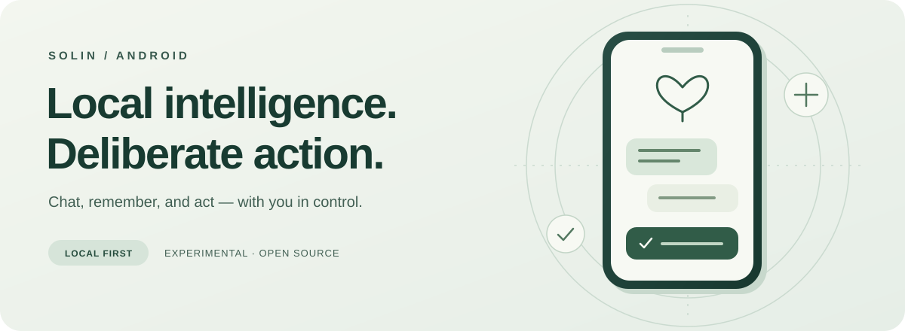

# 栖知 Solin

**隐私优先的 Android 助手：本地对话、本地记忆，以及受控的手机操作。**

[](https://github.com/William-zgx/solin-android/actions/workflows/android.yml)
[](#快速开始)
[](#许可证)
[](#当前状态)

[English](README.md) · 简体中文

[快速开始](#快速开始) · [手机控制](#手机控制范围) · [隐私契约](#产品契约) · [文档](#文档) · [参与贡献](#贡献)

<p align="center">
  
</p>

*概念插画，非应用截图。*

Solin 在手机上运行 LiteRT-LM 对话，将记忆保留在本机，并通过观察—行动循环使用工具。
OpenAI 兼容远程端点为可选能力。权限、隐私和实时动作检查共同决定哪些操作可以执行，
关键控件始终由用户亲手操作。

## 实现要点

| 能力 | 当前实现 |
| --- | --- |
| 本地对话与图片 | 已校验 E2B/E4B Text+Vision 模型、GPU/CPU 回退、有界图片输入 |
| 本地记忆 | 轻量本地索引；Embedding 运行时探测通过后启用语义召回 |
| 手机工具 | 提醒、草稿、导航、屏幕文本、OCR、联系人、日历和低风险应用搜索 |
| 手机操作可靠性 | 输入读回、有界稳定检查、采集、查找与 NumberPicker 调节 |
| 路线复用 | 同会话、同请求的已验证短搜索路线；每步重新授权 |
| 可选远程推理 | OpenAI 兼容聊天、显式远程视觉自动化及可选云路由 |
| 后台显示实验 | 仅 debug、显式授权的独立显示；独立焦点应用启动要求兼容的 Android 14+ |

Solin 处于**实验阶段**，适合本地开发与个人评估，尚未准备好大规模应用商店分发。
[当前限制](#当前状态)与[发布就绪状态](docs/release_readiness.md)区分已实现功能、
设备支持证据和发布批准。

## 快速开始

使用 **JDK 21** 与 CI 对齐，安装 Android SDK platform 36、build-tools 36.0.0 和
platform-tools。compile/target SDK 为 36，最低 Android API 为 28，当前原生构建面向
arm64-v8a。Java/Kotlin 输出目标为 Java 17；`doctor.sh` 检查的最低 JDK 为 17。

```bash
git clone https://github.com/William-zgx/solin-android.git
cd solin-android
export ANDROID_HOME=/path/to/android-sdk
export ANDROID_SDK_ROOT="$ANDROID_HOME"
scripts/doctor.sh
./gradlew :app:assembleDebug
adb install -r app/build/outputs/apk/debug/app-debug.apk
```

真实 LiteRT-LM 验证应使用兼容 Android 真机；模拟器工具测试不代表模型质量或性能通过。

### 首次打开与信任流程

在应用内选择一种开始方式：

1. **本地使用**：下载推荐 E2B 模型，或导入受信任且兼容的 `.litertlm` 文件。不支持的模型
   能力会明确拒绝。
2. **远程使用**：配置 OpenAI 兼容端点与模型，选择远程模式。自动模式也可选择满足条件的
   已配置端点。
3. **模型管理**：查看安装、校验和运行时状态，管理可选记忆/动作模型。

下载默认等待 Wi-Fi。暂停时可显式选择**用移动数据继续**，已知时会显示剩余大小。
单独下载期间仍可编辑远程配置；模型加载或运行中的任务可能阻止冲突操作。

## 产品契约

- **默认留在本机。** 聊天历史、记忆、私有工具结果、屏幕文本、OCR 和本地附件默认不上云，
  除非用户选择获准的远程路径。未知隐私元数据按 `LocalOnly` 拒绝外发。
- **默认只确认关键操作。** 获准的可撤销步骤可以直接执行。外发、未知工具、模型标注敏感
  步骤，以及含敏感信息或读过隐私数据后的联网查询需要确认。读过隐私数据后，输入用户
  未提供的文字也要确认；向其他 App 传递敏感文字或此后新编写的文字同样受检查。仅由
  用户原话构成、非敏感且未触发其他关键规则的草稿可自动批准。
- **关键控件由用户操作。** Agent 不点击支付、发送、删除、发布、下单、转账或授权控件。
  信任中心可将普通动作切回“每步确认”。
- **远程视觉先批准。** 截图外发要求显式开关、远程模式、支持图片的模型，以及本次运行
  首个应用内步骤的用户确认，两种确认模式都适用。每次外发均有审计，不记录原始 prompt。
- **用户持续掌握控制。** 可以清除密钥、会话与记忆。权限丢失、模型不支持或结果无效，
  都不能静默启用另一条数据路径。

完整数据与同意规则由[隐私说明](docs/privacy_notice.md)维护。可选云路由是独立开关：
在 Shadow 或 Active 模式下，满足条件的请求文字可能发给配置的决策模型，并非纯本地
策略。见[自动推理状态](docs/specs/20260718-adaptive-edge-inference/status.md)。

## 手机控制范围

本地路径支持观察、点击、输入、搜索提交、滚动、滑动、长按、返回、等待和固定白名单
系统按键，仍须满足实时页面和隐私守卫。输入读回与有界控件树稳定检查会明确标记
不确定结果，不盲目重放写操作。

| 工具 | 边界 |
| --- | --- |
| `ui_collect` | 有界多页读取；片段结果不证明整个列表已读完 |
| `ui_find` | 精确查找并检查歧义；找到目标不自动点击 |
| `ui_set_wheel` | 仅支持可识别 NumberPicker；必须读回最终目标值 |

每个组合子步骤都重新授权。本地观察规划优先使用已校验 E2B/E4B Chat 模型，实验动作
模型作为回退。后续操作受目标包名及新鲜证据约束；规划不可用时保守回退。验证路线
复用不携带旧授权或旧坐标。

**远程视觉**可以使用无障碍截图与可见控件文字规划本地动作，动作仍经过相同守卫。
该能力默认关闭，并遵守上文批准规则；普通屏幕文本证据保持 `LocalOnly`。

**后台显示**是单独的 debug 实验，需要已授权 ADB 显式配置与用户选择。helper 要求
Android 12+；启动独立焦点的后台应用要求 Android 14+ 及平台支持。会话丢失或过期时
拒绝操作，不切回主屏；该作用域禁用远程视觉和主屏 MediaProjection OCR。

合同、限制、来源与操作方式：[手机能力](docs/plans/mika-phone-capabilities.md) ·
[设备验收](docs/phone_acceptance.md)。

## 推荐模型

文件通过大小和 SHA-256 校验后登记；存在文件不代表运行时及全部能力在当前设备上可用。

| 用途 | 产物 | 下载大小，约 |
| --- | --- | ---: |
| 默认本地聊天 | E2B `.litertlm`，Text+Vision | 2.59 GB |
| 可选本地聊天 | E4B `.litertlm`，Text+Vision | 3.66 GB |
| 语义记忆 | EmbeddingGemma `.tflite` + tokenizer | 184 MB |
| 实验动作回退 | mobile-action-270m `.litertlm` | 284 MB |

以上为十进制单位。精确字节数、固定来源、哈希及人工许可审核状态见[模型清单](docs/model_manifest.md)。
权重不进 Git，普通公共产物不打包模型；[内部 bundledModels 包](docs/bundled_model_package.md)
有独立的构建、安装与再分发要求。

## 配置与密钥

在应用内配置远程端点和凭据。开发脚本可以使用环境变量，其值不能提交到仓库。

| 变量 | 用途 |
| --- | --- |
| `ANDROID_HOME` / `ANDROID_SDK_ROOT` | Android SDK 位置 |
| `ANDROID_SERIAL` | 选择一台已授权手机或模拟器 |
| `SOLIN_HF_TOKEN` | gated bundled-model 下载；访问权限不等于许可证批准 |
| `SOLIN_LIVE_REMOTE_BASE_URL`、`SOLIN_LIVE_REMOTE_MODEL`、`SOLIN_LIVE_REMOTE_API_KEY` | 远程调试评估；秘密不得写入报告 |
| `RELEASE_KEYSTORE` 和相关签名变量 | 仅私有签名环境使用 |

## 验证

```bash
# 完整本地门禁：脚本回归、JVM、Lint、构建及产物检查
scripts/verify_local.sh

# 设备检查；在个人设备上运行前先阅读验收指南
ANDROID_SERIAL=<device-or-emulator> scripts/install_and_test_device.sh

# 完整模拟器回归
AVD_NAME=<your-avd-name> scripts/regression_emulator.sh
```

完整模拟器通过必须有 `regression-emulator.properties` 的 `status=passed`。
CI 任务因基础设施不支持（如 HVF 不可用）而跳过，即使显示绿色也不代表实际设备覆盖。
模型驱动的应用搜索还要求指定模型和经过验证的 query/package/app 守卫。

按提交记录的结果见[验证报告](docs/validation_report.md#2026-11-04--main-ci-convergence)。
语音输入、系统选择器、MediaProjection 同意、物理设备行为和发布批准需要各自证据。

## 当前状态

- **实现不等于通用支持。** WebView、真实滚轮、OEM 焦点/生命周期和完整模型任务仍需
  补充验收；后台显示的负向设备测试仍待完成。
- **没有基准提升结论。** 有效的前后配对手机任务比较尚未完成；单元测试通过不证明
  任务成功率或性能提升。
- **没有公共发布批准。** 模型许可、再分发、隐私/法务审核、签名和物理设备证据仍是
  独立门禁。
- **仓库仅保存源码与配套资料。** 模型权重、凭据、keystore、用户数据和生成的发布
  产物不进 Git。

## 文档

| 需要了解 | 从这里开始 |
| --- | --- |
| 架构与代码地图 | [Guidebook](Guidebook.md) → [核心模块](docs/agent_core_modules.md) |
| 数据和同意规则 | [隐私说明](docs/privacy_notice.md) |
| 使用与设备验收 | [手机验收](docs/phone_acceptance.md) |
| 模型来源和分包 | [清单](docs/model_manifest.md) · [bundled models](docs/bundled_model_package.md) |
| 发布状态和证据 | [就绪状态](docs/release_readiness.md) · [验证报告](docs/validation_report.md) |
| 全部事实归属文档 | [文档索引](docs/index.md) |

## 贡献

先读 [AGENTS.md](AGENTS.md) 与相关 owner 文档。保持变更聚焦，在受影响边界补测试，
按变更选择验证层级。纯文档变更运行相关链接、格式和记录检查；代码变更发起 PR 前应
通过完整本地门禁。工具 schema 测试、低风险手机夹具、可访问性和文档修正都适合作为
起点。

## 安全

私有端点、凭据、个人数据、敏感截图和受限模型文件不要放入公开 issue。安全问题应
私下联系仓库所有者，提供受影响提交、设备/API 与最小安全日志。隐私相关改动运行
`scripts/privacy_scan.sh`。秘密进入 Git 历史后应先撤销，再清理历史并轮换凭据。

## 许可证

Solin 自有代码使用 [MIT](LICENSE)。从 Mika 适配的部分保留
[Apache-2.0](licenses/Apache-2.0.txt)，见 [NOTICE](NOTICE) 与源码声明。推荐模型为第三方
产物，遵循各自条款和[审核要求](docs/model_license_review.json)。
