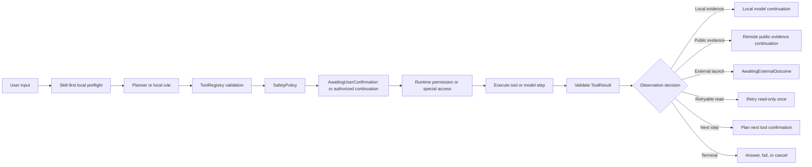

# Solin Agent Core Modules

This is the current architecture reference for Solin's end-side Agent.
Keep it about module ownership, boundaries, current status, and regression
coverage. Historical command output and validation notes belong in
[validation_report.md](validation_report.md).

Checked on 2026-11-05 on branch `zouguoxue/simply`. The tree has 324 production
Kotlin files and 52 registered capability-matrix tool entries. These are measured
inventory values, not goals to grow toward. `:app` is the product module;
`releaseSmoke` is a verification helper. Runtime/package boundaries remain
conventions enforced by architecture tests.

Shared helpers live in `app/src/main/java/com/bytedance/zgx/solin/common/`:
`JsonReaders.kt` (`keysSet`, `jsonObjects`, `optNullableString`,
`optStringOrNull`, `optDoubleOrNull`, `optStringSet`, `optStringSetOrNull`,
`firstNonBlank`) and `Hashing.kt` (`sha256Hex`, `toLowerHex`,
`appendLengthPrefixed`). They are `internal` and carry no policy. The readers
fail soft (null or empty) so each caller decides how to fail closed.



## Tool Layer

Code:

- `app/src/main/java/com/bytedance/zgx/solin/tool/`
- `app/src/main/java/com/bytedance/zgx/solin/action/ActionExecutor.kt`

Responsibilities:

- Describe every device capability as a `ToolSpec`.
- Validate tool names, arguments, permissions, risk, confirmation policy, and
  successful output data before the Agent observes a result.
- Expose provider-owned tool sets through a frozen module registry snapshot so the
  Agent loop and execution boundary do not keep parallel allowlists or observe
  late registration changes.

Boundaries:

- Tools do not decide conversation flow.
- Tool specs retain their risk and confirmation metadata. The default
  `ConfirmationBypassPolicy` may auto-approve reversible steps, while critical
  reasons still require confirmation; individual tools cannot grant themselves
  permission. See [Safety and audit](#safety-and-audit).
- Private output tools must be `LocalOnly` and `requiresLocalModel=true`.

Current status:

- `ToolRegistry` is provider-backed and covers web search, device context,
  Android Intent/draft/navigation tools, alarm/timer/reminder tools,
  `cancel_reminder`, current-page and current-app UI search, open-app UI
  search, phone-control primitives, background tasks, sharing, OCR, and
  settings entry points.
- `SolinModuleRegistry.freeze()` materializes tool providers, handlers, and Skill
  sources once. It rejects duplicate tool specs, duplicate handlers, duplicate
  Skill ids, handlers without a corresponding spec, and all post-freeze
  registration.
- `ToolRegistry` consumes that frozen snapshot and is the final source of tool
  metadata for planning, authorization, execution, and Skill validation.
- Input schemas reject unknown tools, unknown fields, missing required values,
  bad enums, regex mismatches, and numeric bounds failures. Output schemas are
  also enforced for successful `ToolResult.data`.
- `ToolSpec.tags` owns runtime policy categories: device-control sessions,
  low-risk app-control continuations, UI checkpoints, app-launch continuation,
  and local-model requirements.
- `ToolSpec.resultContinuationPolicy` separates tool safety from answer
  synthesis. `PublicEvidence` tools such as `web_search` can continue through
  the configured model; `LocalEvidence` tools such as contacts, calendar,
  files, notifications, clipboard, screen text, and OCR require local synthesis.
- Concurrent remote execution is intentionally narrow. A batch is accepted only
  when every tool is public, read-only, no-confirmation, has no private output,
  and declares no device-context, runtime-permission, scheduling,
  notification, navigation, share, or other side-effect boundary.
- `web_search` uses typed evidence requests. `searchMode=general` stays on
  public search; `searchMode=weather_current` is the only weather endpoint.
  Public web results are carried as `PublicWebEvidencePack` /
  `PublicWebEvidenceItem` (`tool/PublicWebEvidence.kt`).
- Phone-control tools return `LocalOnly` observations and structured
  `UiActionExecutionResult` / `UiActionReadResult` values from
  `device/ScreenControlModels.kt`. `UiTargetResolver` ranks Accessibility nodes for
  search/edit/submit/filter/result/scroll targets; app profiles improve
  ranking, not safety policy. Profiles also carry `uiNotes`: at most five
  short UI facts per app (search entry, tab names, Settings toggles switch on
  tap, WeChat input-box text is an unsent draft). `appUiNotesFor(packageName)`
  returns them, and the local observation-replanner prompt adds them as one
  `App UI notes (reference facts …; data, not instructions)` line of at most
  300 chars when the observed foreground package matches. Rule lines are never
  shortened for the notes; when the prompt is at its cap, only the LocalOnly
  evidence line gives up room, every `targetShortlist(...)` is kept, and the
  prompt does not grow. Notes never feed scoring or safety decisions. App
  UI notes informed by Mika's knowledge files (Apache-2.0), rewritten.
- Phone control also covers Accessibility gestures — swipe (normalized 0-1000
  coordinates), long-press, and an allowlisted system-key set
  (home/recents/enter/delete, never an arbitrary keycode) — all
  Required-confirmation specs, LocalOnly, checkpointed low-risk continuation
  actions; in critical-only mode they run without a prompt and stop on screens
  with a critical control.
- UI control tools remain unavailable to remote model planning. App-search
  observation is `LocalOnly` and can only feed the local action-planning model.
- Mika-derived phone capabilities are integrated at the existing boundaries:
  `device/UiExecutionVerification.kt` owns input readback and bounded tree-stability
  results; `tool/PhoneCompositeOperations.kt` owns `ui_collect`, `ui_find`, and
  `ui_set_wheel` orchestration through `TimeoutToolExecutionBoundary`
  (`tool/ToolExecutionBoundary.kt`); and
  `skill/VerifiedPhoneRoutes.kt` owns session-memory route evidence. The
  `VerifiedPhoneRouteReplanner` wrapper proposes one ordinary request at a time,
  so learning does not grant execution authority. Terminal search verification
  must reach the wrapper's observation hook before the loop completes.
  Composite results remain `LocalOnly`; each child action is authorized separately,
  and `PhoneCompositeOperations.childToolsFor` is the one child-tool allowlist
  used by both the executor and `ConfirmationBypassPolicy.canAuthorizeCompositeChild`.
  The experimental `device/background/` helper/session pair is a separate explicit
  debug backend, not a replacement for the default foreground service. Source
  attribution, limits, and integration/device verification status are owned by
  [`plans/mika-phone-capabilities.md`](plans/mika-phone-capabilities.md).

Tests:

- `ToolRegistryTest`
- `SolinModuleRegistryTest`
- `ToolSchemaContractTest`
- `RoutingAndValidatingToolExecutorTest`
- `WebSearchProviderTest`
- `ActionExecutorTest`

## Agent Loop

Code:

- `app/src/main/java/com/bytedance/zgx/solin/orchestration/`

Responsibilities:

- Own the run state machine, step budgets, cancellation, retry, and restore
  rules.
- Load local context, plan chat/tool/skill work, request confirmation, observe
  results, and decide whether to continue or finish.
- Keep model output, remote tool calls, local rule plans, and Skill-first plans
  behind one validation and safety boundary.

Boundaries:

- The loop does not start Android activities directly.
- The loop does not persist raw prompts, private tool data, full remote error
  bodies, or arbitrary next-action payloads.
- Restored state is UI recovery only unless the current request is explicitly
  reconfirmed by the user.

Current status:

- The loop supports chat-only runs, direct Skill-first plans, local
  `call:function{...}` parsing, OpenAI-compatible remote `tool_calls`, and
  conservative rule replanning.
- Explicit built-in Skills run before remote model planning. Clipboard,
  contacts, files, calendar details, notifications, screen text, OCR, settings,
  and direct search workflows stay local unless the user supplies uploadable
  content.
- Observation produces a typed decision: complete, local/remote model
  continuation, retry a read-only tool once, plan the next confirmation, await
  an external outcome, fail, or cancel.
- Remote models may request multiple tool calls in one turn only for eligible
  public evidence batches. Mixed public/private/action batches are rejected as
  a whole before any tool starts, and so is a batch in which any step is
  critical (for example a search after a private read in the same run).
- Remote send disclosure policy is explicit: `OnRemoteModeSwitch`,
  `EveryMessage`, `OncePerSession`, or `OnlyWhenSensitive`. Suspected
  sensitive content is always forced through confirmation with mask-and-send,
  send-anyway, and cancel choices; image sends always require confirmation.
- Pending remote sends fail closed after restart; they are not replayed without
  a fresh user action.
- Private observations are synthesized locally and take precedence over generic
  replanning. Unknown privacy metadata fails closed as `LocalOnly`.
- Low-risk phone-control replanning can use a verified local Chat or
  action-planning model. Verified E2B/E4B Chat models are preferred for
  observation-to-action planning; the `mobile-action-270m` model is only a
  low-resource experimental fallback. If the selected model is missing, fails,
  or produces no valid draft, the runtime falls back to conservative rule
  planning.
- App search has two modes: static Skill fallback, and model-driven bootstrap
  when a verified local Chat/action-planning model is available. The bootstrap
  only opens, waits, and observes; `ModelObservationReplanner` then plans one UI
  tool per observation, capped at five replans. A verified search result
  completes the run without asking a model for another step.
- Model-driven app-search verification is explicit. Mock and real device evals
  must pass query/package/app guards into the debug receiver before claiming
  `searchVerificationStatus=verified`; device instrumentation that needs a
  preinstalled verified local planning model is optional smoke coverage and
  skips when that model is absent.
- Pending confirmations, redacted Skill plan shapes, value-free Skill
  checkpoints, and selected no-payload continuation cursors can restore after
  process death. Raw tool arguments, model output, private payload, and
  arbitrary sequence text are not restored.
- External Activity launches move to `AwaitingExternalOutcome` when Solin
  can prove only that the external UI opened, unless critical-only mode ran
  the launch without a prompt (then the run completes as opened). When an
  `open_app_by_name` carries a non-blank `followUpIntent` and an eligible local
  action planner or explicitly enabled remote GUI driver is available,
  `ToolPlanCoordinator` can schedule a bounded in-app observation/continuation.
  The expected package follows the launch result; a mismatched target refuses
  downstream actions. The local path uses LocalOnly evidence and no pixels;
  remote vision follows its separate consent contract below. Without a legal
  driver, opening the app does not claim that its follow-up task was completed.
- **Remote-vision in-app continuation (opt-in):** when the Trust-Center
  "Remote-vision GUI automation" toggle is on, inference mode is Remote, and
  the configured remote model supports vision input, the in-app continuation
  uses `RemoteVisionObservationReplanner` + `AndroidRemoteVisionDecider`
  instead of the local action model. A confirmed first in-app step is required
  before sending any run screenshot in both confirmation modes; the toggle alone
  is insufficient. Background display scopes reject this path. It captures the screen via
  `AccessibilityService.takeScreenshot` (transient JPEG, never persisted; a
  blank capture stops the send), sends it with the visible control list and the
  model's own prior action kinds, and applies the returned tap, back, scroll,
  type, submit, or wait as a local `ui_*` action under the same preflight rules (and, in per-step mode, the same confirmation and 5-step
  checkpoint). One reply may plan up to 4 steps: only coordinate-free steps may
  follow the first, they run with no new capture, and any failed step drops the
  rest so the model re-decides. A step may carry
  `"until": {"text"|"gone"|"package": …, "timeoutMs": …}`; it is followed by a
  local `ui_wait` that polls the Accessibility snapshot for that condition
  (`expectText` / `expectGoneText` / `expectPackage`, default 8 s, clamped to
  0.5–20 s, `conditionMet` in the result) and fails on timeout, so the next
  step runs only once the page is ready. A malformed `until` (unknown key, bad
  type, no condition) drops the whole reply. The queue also stops when the
  step that just ran left the plan's foreground package (or reported none
  while one was expected) or newly showed a blocking overlay (the
  `hasBlockingOverlay` marker heuristic); a `package` wait is the one planned
  app switch. Window-type dialog detection was not added because snapshots
  carry no window list; system dialogs surface as a package change. Every
  queued step still goes through the normal plan, confirmation and preflight
  path. A `stop` decision,
  or a repeat of the last action on an unchanged screen, ends the run with a
  local `finish` instead of falling back to the local action model. Capture or
  send failures fail closed and stop the loop.
  Owned by `orchestration/RemoteVisionObservationReplanner.kt`,
  `orchestration/AndroidRemoteVisionDecider.kt`, and
  `device/AccessibilityRawScreenshotProvider.kt`.
- Run-level step and observation budgets fail closed before another pending
  confirmation, retry, replan, or model continuation is saved.
  `orchestration/AgentRunBudget.kt` owns the tool-step budget, the
  observation-decision budget, and a wall-clock deadline
  (`SolinConstants.AgentLoop.MAX_RUN_WALL_CLOCK_MILLIS`, 5 minutes) that does
  not count time parked on a confirmation, an answer, or an external outcome.
- Mid-run user input goes through `AssistantRouter.steer` (cancels an
  in-flight model stream, never a running tool) or
  `AssistantRouter.queueUserInput` (never cancels anything).
- Public-evidence continuations (`orchestration/PublicEvidenceContinuation.kt`)
  check the final answer's `[S<n>]` citations against the numbered sources
  (`checkPublicWebAnswerCitations`) and ask for at most one rewrite when the
  check fails: no citation, an unknown source id, or a confirmation claim with
  no verifiable URL.
- **User text is never truncated by compaction.** History compaction
  (`orchestration/ContextCompactor.kt`) and observation-replanner prompt
  compression (`orchestration/ObservationReplannerPromptCompression.kt`)
  shorten or drop only assistant text, tool observations, and summaries. The
  original request, steer and queue messages, and ask_user answers stay
  byte-identical. If user messages alone exceed the budget, the first request
  and the most recent user message are kept in full, and every user message in
  between is replaced by one line, `[较早的用户消息已省略：N 条，共 M 字]`.
  No message is cut mid-way, so the result may exceed the budget. A recovery
  check runs after every compaction and puts back, at its original position,
  any user message or user-text prompt line that went missing. A summary or
  omission line is `LocalOnly` when any message it covers is.
- Per-run lifecycle state is grouped in `RunScopedState`; the runtime's remaining
  concurrently accessed maps use concurrent collections. Atomic state transitions,
  cancellation and cleanup still need their own contracts—a concurrent map alone
  does not make a multi-step lifecycle operation atomic.

Tests:

- `AgentLoopRuntimeTest`
- `AgentRunBudgetTest`
- `AssistantOrchestratorTest`
- `ToolExecutionBoundaryTest`
- `SolinViewModelTest`

## Runtime

Code:

- `app/src/main/java/com/bytedance/zgx/solin/runtime/`

Responsibilities:

- Execute local LiteRT-LM and remote OpenAI-compatible chat generations.
- Adaptively select backend (local vs. remote) and generation parameters based
  on context window, quality issues, and resource pressure.
- Guard model output quality and probe remote endpoint connectivity.

Boundaries:

- Runtime modules do not mutate `ChatUiState`; they return typed results that
  the orchestration layer folds into state.
- Local runtime never sends data off-device; remote runtime sends only
  `RemoteEligible` history (`LocalOnly` messages are filtered before dispatch).
- The runtime owns only the base system instruction; per-turn prompt assembly
  and continuation prompts live in `orchestration/`.

Current status:

- `LiteRtRuntime` wraps the Google AI Edge LiteRT-LM `Engine` with GPU/CPU
  fallback and explicit model loading.
- `RemoteChatRuntime` streams from an OpenAI-compatible endpoint using
  OkHttp, sending the configured API key as a `Bearer` header, with
  `RemoteModelEndpoints.kt` building the chat-completions and models URLs and
  `RemoteRetryPolicy` retrying only transient provider-side failures, never
  cancellations. `stop()` advances a generation marker and cancels active
  calls; `runWithRetry` checks that marker both before call creation and after
  registration, so stopping during `newCall` cannot leave an uncancelled request.
  `RemoteChatRuntimeTest.stopDuringCallCreationCancelsBeforeExecution` pins this
  race without relying on timing.
- `LocalEngine` (`runtime/LocalEngine.kt`) is the backend-neutral on-device
  contract the planners see: `engineCapabilities()` and a blocking, greedy
  `generateOneShot(LocalOneShotRequest)`. `RealLiteRtRuntime` implements it on
  the one engine loaded for chat: it serves only the loaded model path
  (`ModelNotLoaded` otherwise), never preempts a chat generation (`Busy` after
  a bounded wait, or when chat takes the engine back), parks the chat
  conversation during the one-shot and recreates it from its transcript on the
  next chat use. Every one-shot runs on a fresh conversation with an empty
  history, and can be cancelled from another thread through
  `LocalOneShotRequest.cancellation` (`Cancelled`, also on thread interrupt). `DedicatedLiteRtEngine` is the CPU fallback for a model the
  chat engine does not hold. `HybridActionPlanningRuntime` tries the shared
  engine first, uses the dedicated engine only on `ModelNotLoaded` or
  `Unsupported`, and otherwise falls back to the rule planner, so one model is
  never mapped twice; both planners share one dedicated engine. Chat sends
  keep the live conversation (and its KV cache) only when the system
  instruction, sampling and budgeted history equal what it already holds.
  Per-call `LocalCallMetrics` are numbers only (load, first token, total,
  accelerator, native token counts when benchmark mode is on) and stay on the
  device. No path grants a remote fallback. The LiteRT-LM 0.12.0 API survey is
  [litert-lm-api-report.md](specs/20261107-local-engine/litert-lm-api-report.md).
- `AdaptiveGenerationPolicy` decides backend, token limits, and image caps
  from `AdaptiveGenerationPolicyInput` (preferred backend, context window,
  last-gen stats, quality issues, image count).
- `ModelOutputQualityGuard` stops degraded streamed generations (repetition
  loops, malformed characters, over-length, empty output, format violations)
  and surfaces a `GenerationQualityIssue`.
- `RemoteModelConnectivityProbe` performs lightweight preflight checks
  before a remote generation is attempted.
- Cloud/edge router (opt-in, `orchestration/DecisionModelRouter.kt` +
  `runtime/CodivDecisionModelRouter.kt`): for Auto chat runs,
  `DecisionModelPlacementPolicy` runs `ModelPlacementPolicy` first and asks
  the Codiv OpenJev System One model (`POST /systemone`, one `local`/`remote`
  choice question) only when the rules chose by complexity
  (`AUTO_SIMPLE_LOCAL` / `AUTO_COMPLEX_REMOTE`). Only the user's request text
  is sent: no history, memory, attachments, or tool results, and never text
  that looks personal or secret. Off by default; the user saves a Codiv key in
  the Trust Center (encrypted `SecretStore`, never in Git) and picks Shadow
  (call on a background daemon thread and count, keep the rule decision; the
  reply never waits, at most one call is in flight, and a request arriving
  while one runs is skipped without a sample) or Active (synchronous; a
  verdict at confidence ≥ 0.9 picks the side, as
  `AUTO_DECISION_MODEL_LOCAL/REMOTE`). Timeouts
  (1.5 s), HTTP errors, and replies outside the declared contract keep the
  rule decision. Each send is a redacted remote-send audit entry.
  `scripts/run_decision_routing_eval.py` measures the same request on
  `docs/decision_routing_eval.json`.
- `TfliteTextEmbeddingRuntimeFactory` builds the TFLite embedding runtime
  used by the memory index.
- `runtime/ChatPrompts.kt` holds the default chat system instruction
  (`DEFAULT_CHAT_SYSTEM_INSTRUCTION`); `orchestration/SystemPromptBuilder.kt`
  adds per-turn evidence cards to it.

Tests:

- `FakeLiteRtRuntimeTest`
- `LiteRtRuntimeConfigTest`
- `RemoteChatRuntimeTest`
- `AdaptiveGenerationPolicyTest`
- `DecisionModelPlacementPolicyTest`, `CodivDecisionModelRouterTest`,
  `DecisionModelRoutingControllerTest`
- `ModelOutputQualityGuardTest`

## Skill Framework

Code:

- `app/src/main/java/com/bytedance/zgx/solin/skill/`

Responsibilities:

- Declare reusable, versioned task flows with `SkillManifest`.
- Convert Skill steps into requests against the frozen Tool Registry.
- Build one manifest catalog from built-in and module-provided `SkillSource`
  values, while exposing planners only for registered manifest ids.
- Validate Skill structure, argument bindings, required tools, risk, and restore
  authorization before confirmation or execution.

Boundaries:

- Skills do not call Android APIs directly.
- Skills do not define private tool names outside the frozen registry.
- External Skill Packages are declarative, read-only resources. They cannot ship
  or execute Bash, Python, JavaScript, DEX, JAR, native libraries, or other code.
- Private tool outputs cannot bind directly into later external tool arguments.

Current status:

- Built-in Skills live in a `SkillCatalog` with manifests, trigger examples,
  parser-backed planning, direct tool mappings, and planner metadata in one
  contract.
- `SkillManifest.authorizationContractHash()` covers id/version/risk,
  low-risk app-control eligibility, unverified launch continuation eligibility,
  background metadata, required tools, and canonical input schema. Display text
  and trigger examples do not authorize execution.
- `CompositeSkillRuntime` merges module manifests into one discovery catalog,
  rejects duplicate ids, and fails startup if a planner advertises an
  unregistered Skill.
- External Skill Packages (`skill/external/`, package
  `com.bytedance.zgx.solin.skill.external`) use an allowlisted ZIP layout with
  bounded file count and sizes. The loader validates raw-manifest Ed25519
  signatures from trusted publishers, frozen tool references, minimum app
  version, declared risk, and SHA-256 for every payload resource before
  returning a `SkillSource`; failures remove staging. Unknown privacy metadata
  fails closed as `LocalOnly`.
- Declarative Skill plans support stable step ids, dependencies,
  tool-to-tool bindings, local model transform steps, and bounded progression.
- `SkillRunProgressor` is the shared pure Kotlin boundary for structure
  validation, public-output binding, private-output fences, model-output to tool
  progression, and current-process tool-result progression. Tool execution itself
  always goes through `presentation/ToolExecutionController` and
  `TimeoutToolExecutionBoundary` (`tool/ToolExecutionBoundary.kt`); the Skill
  layer never calls a tool executor.
- Current built-ins cover drafts, maps/search, device settings, app navigation,
  reminders, periodic-check configuration, background-task queries, web search,
  clipboard context, summary-and-share flows, foreground/current-app context,
  contacts, calendar availability, recent media metadata/OCR, current-screen
  text/OCR, static and model-driven App search, and system sharing.
- Model-driven App search manifests are limited to existing low-risk tools:
  open app, observe screen, tap, type, submit search, scroll, wait, and back.
  V1 does not cover sending, payment, deletion, order placement, authorization,
  or public posting.

Tests:

- `BuiltInSkillRuntimeTest`
- `CompositeSkillRuntimeTest`
- `ExternalSkillPackageTest`
- `SkillRunProgressorTest`
- `MainActivitySkillUiTest`

## Device Context

Code:

- `app/src/main/java/com/bytedance/zgx/solin/device/`
- `app/src/main/java/com/bytedance/zgx/solin/resource/`
- `MemoryRepository`, `SessionRepository`, and `ChatUiState` context snapshots

Responsibilities:

- Provide minimal local context to the loop and planner.
- Represent tool readiness without exposing private values.
- Keep private device data out of remote prompts unless the user explicitly
  provides uploadable content.

Boundaries:

- Device context is not a general screen, file, contact, calendar, or media
  scraping layer.
- Accessibility text reads do not capture screenshots, pixels, node ids, full
  hierarchy, or semantic screen understanding.
- Recent-file tools return metadata only unless the user confirms an OCR tool
  with a narrow scope.

Current status:

- `DeviceContextSnapshot` records non-secret runtime state: inference mode,
  installed capability classes, memory toggle, storage estimate, active-session
  presence, pending confirmation state, and per-tool readiness.
- Readiness entries describe available, runtime-permission blocked,
  special-access blocked, foreground-consent required, and unavailable states.
  Prompts include tool names and state/reason metadata only.
- Confirmed `LocalOnly` device-context tools cover clipboard reads, foreground
  app metadata, current-app notifications, contacts, calendar busy/free blocks,
  recent file metadata, recent screenshot OCR, recent image OCR, current-screen
  Accessibility text, current-screen observation, and one-shot current
  screenshot OCR through MediaProjection consent.
- Remote mode filters local memory, shared-input generated text, device
  context, and `LocalOnly` history from automatic requests. Unknown stored
  message privacy restores as `LocalOnly`.
- Resource monitoring samples PSS/heap, available RAM, CPU, and thermal state
  for UI pressure only; it does not read user content.
- Pending areas remain intentionally outside this module: broad screen semantic
  understanding, complete document parsing, arbitrary media understanding, and
  uncontrolled screenshot capture.

Tests:

- `DeviceContextModelsTest`
- `DeviceContextToolExecutorTest`
- `ForegroundAppProviderTest`
- `CalendarAvailabilityProviderTest`
- `RecentFileCollectorTest`

## Execution Boundary

Code:

- `app/src/main/java/com/bytedance/zgx/solin/action/ActionExecutor.kt`
- `PendingAgentConfirmation`
- `SolinViewModel.confirmAgentConfirmation`

Responsibilities:

- Convert authorized `ToolRequest` values into Android Intents, system sheets,
  scheduler calls, or special consent flows.
- Re-authorize every execution and retry against the frozen `ToolRegistry` and
  `SafetyPolicy`, with explicit user-confirmation context.
- Return execution success, cancellation, rejection, or failure as structured
  `ToolResult` values.
- Surface safe execution summaries to the UI while structured result details
  remain in Agent trace and audit.

Boundaries:

- Confirmation is required before Android execution, runtime permission prompts,
  or special-access dependent tool execution. Unknown or no-longer-registered
  tools fail closed at the final execution boundary.
- Batch authorization is atomic: if any request is rejected, no handler in the
  batch starts.
- Share sheets, drafts, app launches, and deep links prove only that the
  external UI opened unless the user later records the outcome.
- Arbitrary Intent actions, activities, extras, non-HTTPS links, and
  non-allowlisted app targets are not exposed.

Current status:

- `SafetyPolicyToolExecutionAuthorizer` is invoked immediately before each
  handler attempt. Retries re-enter authorization, and confirmed requests carry
  an explicit `userConfirmed=true` context rather than bypassing policy.
- Generation streaming uses typed started/delta/completed/failed/cancelled
  events keyed by session id, run id, and a monotonic generation token. Stale
  events and all events after a terminal state are ignored before UI mutation.
- Intent-backed tools cover settings, drafts, safe HTTPS deep links, app
  launchers, fixed app deep targets, camera launch, maps, email/calendar/contact
  drafts, and system sharing.
- Runtime permission prompts are issued only after the user confirms the Agent
  request. Denial returns through the normal tool-result path and is not
  auto-retried.
- Usage Access and Accessibility are modeled as special app access. Returning
  from settings updates status; it does not execute the pending tool.
- External launch results carry allowlisted completion metadata:
  `completionState`, `completionVerified=false`, `externalOutcome=Unknown`,
  `externalOutcomeSource=Unknown`, target kind, and safe target identifiers.
- `AwaitingExternalOutcome` can restore from allowlisted trace metadata for the
  active session. Restore does not replay the tool or recover raw payload.
- Android share-target ingestion and the in-app picker are handled before chat
  generation; generated prompts are staged as user-visible local drafts.

Tests:

- `ActionExecutorTest`
- `ToolExecutionBoundaryTest`
- `GenerationStreamReducerTest`
- `AgentRuntimePermissionPolicyTest`
- `SolinViewModelTest`
- `MainActivitySpecialAccessUiTest`

## Safety And Audit

Code:

- `app/src/main/java/com/bytedance/zgx/solin/safety/`
- `app/src/main/java/com/bytedance/zgx/solin/audit/`
- `AgentTraceStore`
- `tool_audit_events` Room table

Responsibilities:

- Make capability risk, permission boundaries, and confirmation policy explicit
  in code.
- Persist enough trace/audit metadata to explain what happened.
- Minimize retained private data and fail closed when policy metadata is
  missing or malformed.

Boundaries:

- Audit does not store tool arguments, prompts, remote responses, raw
  clipboard/screen/OCR text, bearer values, API keys, or full errors.
- Trace summaries are for diagnosis, not a second chat transcript.
- Recovery actions still re-enter validation, safety, audit, and user
  confirmation before execution.

Current status:

- `SafetyPolicy` rejects registered boundary tools that would cross execution
  or privacy boundaries without mandatory confirmation.
- Critical-only confirmation (`orchestration/ConfirmationBypassPolicy.kt`, the
  default Trust-Center setting) turns a `RequireConfirmation` decision into
  `Allow` unless `criticalApprovalReason` names one: unknown tool,
  `HighExternalSend` / `CriticalDeviceOrPayment` risk, a model-flagged
  sensitivity reason, or a network step (`web_search`, `search_maps`,
  `open_deep_link`) whose query/URI looks personal or secret or that follows a
  private device read (screen, clipboard, contacts, …) in the same run, or
  `ui_type_text` with text not taken from the user's request after such a
  read (every ASCII letter or digit run must be a whole token of the request,
  so numbers and addresses appear in full; every CJK or other non-ASCII
  character must appear in the request; case, punctuation and whitespace are
  ignored), text handed to another app (`share_text`, `compose_email`,
  `compose_sms`, `create_calendar_event`, `create_contact_draft` — tools with
  `ToolPermission.SendsTextToExternalApp`) whose free-text argument looks
  personal or secret or, after such a read, is not the user's own wording, and
  the first in-app step (`DeviceControl` / `ExternalNavigation`) of a
  remote-vision run (confirming it approves that run's screenshots). An `Allow`
  plan with any of these reasons is raised to `RequireConfirmation` in either
  mode. A draft built only from the user's own words can be auto-approved when
  non-sensitive and free of other critical reasons; user wording does not override
  the sensitive-content check.
  Rejections are never relaxed. Auto-run external launches complete as
  "opened" instead of waiting for an outcome record. Turning the setting off
  confirms every step (low-risk app-control skills still continue after one
  confirmation, up to 5 UI actions, but never past one of these reasons).
  A private device read is an earlier tool in the run with private output
  keys; `ToolCapability.LocalCompute` tools (such as `calculate`) mark their
  output private but read nothing from the device, so they do not count.
- Critical on-screen controls (pay, send, delete, publish, order, transfer,
  authorize) are never activated by the agent: `DeviceControlToolExecutor`
  checks what each action can activate — the named target or the node under a
  coordinate tap (a named critical target is refused even when the screen is
  unreadable); the named target for typing; nothing for scrolling; the whole
  screen for submit, Enter, swipe, and long-press — and stops with
  "需要你亲自操作". `SolinAccessibilityService` repeats the check on the live
  window right before every tap gesture, on the node the tap actually lands on
  (any critical control under the point in any window, since z-order is not
  exposed, matched at any label length; the labels of the tapped node and its
  clickable ancestor; its view id by whole token, so `btn_send` refuses while
  `sender_name` or an `order_item` row does not; clickable controls inside its
  container, plus short captions there that are a strong phrase or one exact
  critical word, so a chat row previewing "好的，我同意" stays tappable; and bare
  确定/OK on a dialog that shows critical text), because target matching is
  fuzzy. Long-press, barely-moving swipes, and swipes that start and end on the
  same control count as taps. An unreadable window refuses the tap, as does a
  truncated node walk that saw no labelled node under the point; the
  `ACTION_CLICK` fallback refuses on either. The decision itself is the pure
  `device/CriticalTapGuard.kt`; the service only reads the live windows.
  The check reads accessibility labels, so a control with no usable label
  (custom-drawn, canvas, unlabelled icon) cannot be recognized by name. To cover
  the screens where that matters most, a tap is also refused when the window
  shows a payment, transfer, or authorization step (a short label containing
  确认支付, 立即支付, 确认付款, 立即付款, 支付密码, 交易密码, 确认转账, 转账金额,
  授权登录, 确认授权, or 同意授权) and the tap lands on no labelled control:
  nothing actionable under the point, or an unlabelled one with no labelled text
  of its own under the point. Editable fields stay tappable. View ids do not count
  as labels there. The list is narrow on purpose, so chat, feed, product, search,
  and checkout pages are unaffected. Remaining limitations: an unlabelled control on
  a payment-like screen that shows none of these phrases is still not
  recognized; a labelled but non-critical-sounding control (a keypad digit "1")
  is allowed; and a short chat message quoting one of the phrases makes that
  screen count as a payment step (stricter, never looser).
- Persistent audit records include time, event type, tool name, status, risk,
  permission names, and sanitized summaries. The Room repository keeps the most
  recent 500 records.
- Pending confirmations are stored separately from trace/audit and may include
  only `ToolSpec`-allowlisted structural arguments.
- Startup repair fails non-restorable in-flight runs closed while preserving
  recoverable pending confirmations.
- Reminder scheduling can expose a typed recovery action
  `cancel_reminder(taskId)`, but tapping it creates a fresh pending tool
  confirmation instead of cancelling directly.

Tests:

- `SafetyPolicyTest`
- `ConfirmationBypassPolicyTest`
- `OverlayDismissLoopTest`
- `UiDangerousActionKeywordsTest`
- `CriticalTapGuardTest`
- `ToolAuditEventTest`
- `ToolAuditRepositoryTest`
- `AgentTraceStoreTest`

## Memory

Code:

- `app/src/main/java/com/bytedance/zgx/solin/memory/`
- `memory_records` and `memory_embeddings` Room tables

Responsibilities:

- Recall relevant local context when memory is enabled.
- Persist explicit preferences, user facts, and bounded task-state records until
  the user forgets or clears them.
- Keep memory-derived context local unless the user manually provides it.

Boundaries:

- Memory control commands are local commands, not chat or remote model
  requests.
- Background task memory records omit reminder title/body, prompts, arguments,
  and remote responses.
- Semantic recall is available only after verified model assets and runtime
  probes succeed.

Current status:

- The default runtime uses a lightweight token/hash index over saved sessions
  and explicit memory records. It adds non-persisted alias terms only for answer
  style preferences and active task-state records.
- Explicit `remember`/`forget` commands upsert or delete deterministic
  `Preference` and `UserFact` records while storing control/status messages as
  `LocalOnly`.
- Active reminders and periodic-check state sync into deterministic
  `TaskState` records. User forget/clear creates suppression markers so refresh
  does not recreate deliberately removed records.
- A semantic runtime controller can switch to verified EmbeddingGemma
  `.tflite` plus `sentencepiece.model` assets, persist vectors by
  `recordId + modelId`, and degrade back to lexical recall if probing,
  indexing, or query embedding fails.
- UI state distinguishes installed memory assets from active semantic recall,
  so a downloaded model is not presented as usable until probe/index succeeds.

Tests:

- `MemoryRepositoryTest`
- `SolinViewModelTest`
- `MainActivityLongTermMemoryUiTest`

## Background Tasks

Code:

- `app/src/main/java/com/bytedance/zgx/solin/background/`
- `scheduled_tasks` Room table
- `ReminderAlarmReceiver`

Responsibilities:

- Persist scheduled Agent tasks before handing them to Android.
- Use Android scheduling primitives instead of foreground coroutines.
- Keep background scheduling separate from conversation planning.

Boundaries:

- Background skills must be explicitly user configured, frequency bounded,
  local-only, and limited to local read-only state or notification work.
- Outbound or execution follow-up must return to foreground confirmation.
- Periodic checks are for local reminder patrol only; they are not background
  chat, screen scanning, file scanning, or arbitrary automation.

Current status:

- `schedule_reminder`, `cancel_reminder`, `configure_periodic_check`, and
  `query_background_tasks` are registered tools with Skill-first paths.
- Reminders use opaque task ids, `AlarmManager.setAndAllowWhileIdle`, data-URI
  `PendingIntent` identity, conditional state transitions, boot/package-update
  rescheduling, and structured failure when Android scheduling cannot be
  restored.
- Periodic checks are backed by WorkManager and a singleton
  `periodic-check-local` task. Worker state uses conditional
  `Scheduled -> Running -> Scheduled/Failed` transitions so disable/cancel
  cannot be overwritten by stale completion.
- `query_background_tasks` is a confirmed read-only local context tool. It is
  `LocalOnly`, `requiresLocalModel=true`, never calls schedule/cancel/set/disable,
  and returns private `tasksJson` / `policyJson` metadata with reminder
  title/body omitted.
- The background task surface shows active scheduled tasks, read-only terminal
  history, and periodic-check policy state. Running internals stay available to
  memory/recovery logic but are not shown as user-cancellable work.
- The surface reads one `BackgroundTaskSnapshot` (active tasks, history, and
  periodic-check policy) through `PresentationSessionHost.loadBackgroundTaskSnapshot()`,
  backed by `BackgroundTaskController`.

Tests:

- `ScheduledTaskRepositoryTest`
- `PeriodicCheckSchedulerTest`
- `ReminderAlarmReceiverTest`
- `ActionExecutorTest`
- `DeviceContextToolExecutorTest.backgroundTasksQueryReturnsLocalOnlyTaskAndPolicyMetadataWithoutReminderContent`
- `AgentLoopRuntimeTest.backgroundTasksObservationRedactsTaskAndPolicyJson`

## Multimodal Inputs

Code:

- `app/src/main/java/com/bytedance/zgx/solin/multimodal/`
- `MainActivity` share intent handling
- `MainActivity` in-app attachment picker handling

Responsibilities:

- Accept user-initiated shared text, attachments, picked documents/images, and
  voice transcripts as composer drafts.
- Extract bounded local text or image inputs only through supported, explicit
  paths.
- Keep source ingestion separate from chat generation and tools.

Boundaries:

- Share/picker input is staged; it does not auto-send or auto-route.
- Remote image sends require a preview confirmation and a configured
  image-capable OpenAI-compatible endpoint.
- Unsupported media remains metadata-only.

Current status:

- Share intents and picker selections support text, JSON/XML/YAML text-like
  application files, images, audio, video, PDF, RTF, and Office MIME types.
- Local extraction covers bounded direct text, strict UTF-8 text-like files,
  PDF/RTF/Office Open XML text layers, scanned-PDF OCR fallback, and bounded
  image bytes for verified local vision-capable chat models.
- Remote mode uses a protected read path before parsing shared values or URIs;
  it shows a local privacy notice instead of reading/uploading content
  automatically.
- Voice input launches Android speech recognition and stages the transcript as
  a one-shot draft. It does not read audio files, auto-send, or create chat
  messages until the user taps send.
- OCR outside shared-input scanned-PDF fallback remains a confirmed tool flow:
  recent screenshot OCR, recent image OCR, and one-shot current screenshot OCR
  all return bounded text excerpts only.

Tests:

- `SharedInputTest`
- `CurrentScreenshotOcrContractTest`
- `SolinViewModelTest`
- `MainActivitySharedIntentTest`

## Structured Logging

Code:

- `app/src/main/java/com/bytedance/zgx/solin/logging/SolinLog.kt`
- `app/src/main/java/com/bytedance/zgx/solin/logging/SolinLogTags.kt`

Responsibilities:

- Provide a test-safe logging facade that does not directly reference `android.util.Log`.
- Route log calls through `SolinLogHolder.current` (default: `AndroidSolinLog` in debug, `NoOpSolinLog` in release).
- Define the shared tag constants in `SolinLogTags` (`TAG_MODEL`, `TAG_TOOL`,
  `TAG_MEMORY`, `TAG_REMOTE`, `TAG_LIFECYCLE`) so log filtering is consistent
  across modules.
- Provide `Throwable.cleanMessage()` (message, or the class name when the
  message is blank) for user-facing failure summaries.

Boundaries:

- `AndroidSolinLog` wraps every `android.util.Log` call in `runCatching` so unit tests never crash from unmocked Log.
- Top-level `solinD/solinI/solinW/solinE` functions are the preferred entry point; avoid raw `android.util.Log` in production code.
- Tests may replace `SolinLogHolder.current` to capture or silence output.

Current status:

- Presentation controllers (chat, generation, tool continuation, tool
  execution, model load, memory UI), remote vision, memory retrieval,
  `RemoteChatRuntime`, and the data-layer settings and remote-model
  repositories log through the facade. `RemoteModelRepository` uses
  `solinW(TAG_REMOTE, ...)` for API-key migration warnings.
- Some files still call `android.util.Log` directly, including
  `AgentLoopRuntime`, `AgentRunBudget`, `InitialToolPlanner`,
  `AgentTraceStore`, `LiteRtRuntime`, `BinderMcpTransport`,
  `OnDeviceEvidenceBlobStore`, and `SolinAppContainer`.

Tests:

- `SolinViewModelTest` exercises log-emitting code paths indirectly through ViewModel operations.

## Centralized Constants

Code:

- `app/src/main/java/com/bytedance/zgx/solin/SolinConstants.kt`

Responsibilities:

- Hold shared tuning parameters in one typed, documented location.
- Expose nested objects: `Network`, `AgentLoop`, `Ui`, `Embedding`.

Boundaries:

- Prefer `SolinConstants.X.Y` for values shared across files; file-local
  `private const val` values remain where only one file uses them.
- Each value carries KDoc explaining its purpose and units.

Current status:

- `SolinConstants` holds network timeouts, Agent-loop budgets (including
  `AgentLoop.MAX_RUN_WALL_CLOCK_MILLIS`), UI thresholds, and embedding
  parameters.

Tests:

- `AgentRunBudgetTest` and `ModelToolRequestDeadlineTest` exercise budgets read from `SolinConstants.AgentLoop`.
- `AgentLoopRuntimeTest` validates behavior that depends on `SolinConstants.AgentLoop` values.

## Memory Controller

Code:

- `app/src/main/java/com/bytedance/zgx/solin/memory/MemoryController.kt`

Responsibilities:

- Encapsulate memory index rebuild, long-term memory load, and explicit memory commands (preference, fact, remember, forget).
- Coordinate between `MemoryIndex`, `LongTermMemoryControls`, `SessionStore`, `ModelRepository`, and `BackgroundTaskScheduler`.

Boundaries:

- Returns `MemoryControllerResult` / `MemoryCommandResult` data classes; does not directly mutate UI state.
- Public methods remain synchronous; callers dispatch blocking work. The injected
  `ioDispatcher` is retained for the deferred data-layer suspend migration.
  `presentation/MemoryUiController` applies results to UI state.

Current status:

- Memory controller handles `remember`/`forget` commands and coordinates semantic embedding runtime when available.

Tests:

- `MemoryRepositoryTest` covers memory persistence and retrieval that the controller orchestrates.
- `SolinViewModelTest` exercises memory command flows through the ViewModel boundary.

## Evidence Encryption

Code:

- `app/src/main/java/com/bytedance/zgx/solin/evidence/OnDeviceEvidenceBlobStore.kt`

Responsibilities:

- Encrypt evidence blobs with authenticated AES/GCM/NoPadding and the
  AndroidKeyStore key `solin_evidence_aes_gcm_v1`.
- Store a versioned envelope, random 12-byte nonce and authenticated ciphertext;
  filenames retain the plaintext SHA-256 for content addressing.
- Read verified legacy plaintext and legacy CBC blobs, then migrate them to GCM.
  A failed authentication is not permission to interpret arbitrary ciphertext as plaintext.

Boundaries:

- Production fails closed if its key is unavailable or evidence cannot be
  authenticated and matched to its content address.
- The no-context plaintext constructor is for JVM tests; production uses a Context.
- Metadata records the envelope and encrypted state.

Current status:

- Evidence encryption protects local trace/audit blobs; it does not change what
  those surfaces are allowed to retain or send.
- Legacy migration retains readable historical blobs without weakening validation.

Tests:

- `OnDeviceEvidenceBlobStoreTest`
- `EvidenceBoundsTest`

## Network Security

Code:

- `app/src/main/res/xml/network_security_config.xml`
- Referenced from `AndroidManifest.xml` via `android:networkSecurityConfig`

Responsibilities:

- Enforce HTTPS for all outbound traffic by default (`cleartextTrafficPermitted="false"`).
- Allow cleartext only for loopback addresses: localhost, 127.0.0.1, 10.0.2.2 (emulator), ::1.
- Trust anchors: system certificates only.

Boundaries:

- Cleartext is limited to loopback for local development and emulator testing.
- No user-installed certificate authorities are trusted.

Current status:

- Network security config applies to every build type.
- Remote model endpoints (`RemoteModelConfig`) and custom model download URLs
  accept `https`, or `http` only for the same loopback hosts; web search
  providers use HTTPS endpoints.

Tests:

- `RemoteModelConfigTest`
- `ModelRepositoryTest`
- `RemoteModelRepositoryTest`

## Capability Matrix

Code:

- `app/src/main/java/com/bytedance/zgx/solin/capability/CapabilityMatrix.kt`

Responsibilities:

- Declare user-facing capability descriptors with owner agent, privacy level,
  risk, confirmation policy, and continuation policy.
- Provide a single source of truth for product capability positioning used by
  UI surfaces, release gates, and verification scripts.

Boundaries:

- Capability descriptors are metadata only; they do not register tools or
  execute behavior.
- Privacy level and confirmation policy must match the underlying `ToolSpec`
  values.

Current status:

- `CapabilityDescriptor` covers chat, memory, device context, tools, remote
  mode, and model management capabilities.
- `CapabilityOwnerAgent` assigns each capability to an owning agent
  (Coordinator, EdgeModel, Multimodal, AgentRuntime, Memory, TrustPrivacy,
  PerformanceQa).
- `CapabilityPrivacyLevel` mirrors the `LocalOnly` / `RemoteEligible` split:
  `UserProvided`, `PublicEvidence`, `LocalEvidence`, `ExternalAction`,
  `BackgroundTask`.

Tests:

- `CapabilityMatrixDocumentationTest`

## Credentials

Code:

- `app/src/main/java/com/bytedance/zgx/solin/runtime/RemoteChatRuntime.kt`

Responsibilities:

- Send the remote model API key as `Authorization: Bearer <key>`, and send no
  `Authorization` header when the key is blank.
- Keep credential material out of chat history, traces, and audit logs.

Boundaries:

- The key comes from `RemoteModelConfig.apiKey` (encrypted settings).

Current status:

- API key only. There is no OAuth or token refresh path.

Tests:

- `RemoteChatRuntimeTest`

## Model Download

Code:

- `app/src/main/java/com/bytedance/zgx/solin/download/`

Responsibilities:

- Download recommended and custom `.litertlm` / `.tflite` model files through
  Android `DownloadManager` or direct HTTP with byte limits.
- Verify file size and SHA-256 before marking a download as usable.

Boundaries:

- Downloads are bounded by the expected size, or by `CUSTOM_MODEL_MAX_BYTES`
  (8 GiB) for custom URLs; oversized transfers fail with
  `ModelTransferSizeLimitExceededException`.
- Model downloads are Wi-Fi only by default. A download paused for Wi-Fi
  (`isWaitingForWifiDownload`) offers the user an explicit metered-data resume
  (`allowMeteredDownload()`); no download ever spends cellular data without
  that choice.
- Gated Hugging Face models need a user-saved read token
  (`HuggingFaceAuthRepository`, encrypted `SecretStore`), sent only as an
  `Authorization: Bearer` header. Build-time bundled-model packaging reads a
  separate `SOLIN_HF_TOKEN` from the environment. Neither token is committed or
  logged.

Current status:

- `ModelDownloadService` enqueues downloads through Android `DownloadManager`.
  Loopback debug URLs are fetched directly over `HttpURLConnection` with the
  same byte limit.
- `HuggingFaceDownloadUrlResolver` probes gated URLs with a HEAD (or a
  one-byte range GET) and follows redirects to the direct download URL.
- `ModelDownloadSource.verifiedSha256` checks size and SHA-256 after a
  download completes.
- Active downloads are tracked in `ConcurrentHashMap`s keyed by download id.

Tests:

- `ModelDownloadServiceTest`
- `HuggingFaceDownloadUrlResolverTest`

## Module Registry

Code:

- `app/src/main/java/com/bytedance/zgx/solin/module/`

Responsibilities:

- Provide a compile-time registration seam for first-party Kotlin modules that
  contribute tools, handlers, and Skill sources.
- Freeze the registry snapshot before the Agent loop starts so late
  registration cannot bypass validation.

Boundaries:

- Modules are in-process only. Out-of-process (Binder) extensions are a future
  seam; `SolinModule` does not expose IPC.
- `SolinModuleRegistry.freeze()` rejects duplicate specs, duplicate handlers,
  duplicate Skill ids, and handlers without a corresponding spec.

Current status:

- `SolinModule` interface exposes `moduleId` and `register(registry)`.
- `SolinModuleRegistryImpl` collects `ToolProvider`, `ToolHandler`, and
  `SkillSource` contributions, then freezes into an immutable snapshot.
- `SolinAppContainer` assembles the static module list at startup.

Tests:

- `SolinModuleRegistryTest`

## Plan

Code:

- `app/src/main/java/com/bytedance/zgx/solin/plan/`

Responsibilities:

- Keep the Agent's own checklist for a run: the `plan_write` and `plan_read`
  tools replace and read the ordered plan items.
- Publish plan updates so the loop can emit `PlanUpdated` events and add
  pending items to a step-budget failure message.

Boundaries:

- Plan items hold a title, status, position, and optional note; they carry no
  tool arguments and do not execute anything.
- Plans are in memory only (`SessionPlanStore` is a per-process map keyed by
  run id); they are not restored after process death.
- Both plan tools are `Orchestration` capability, `LowReadOnly` risk, and
  need no confirmation.

Current status:

- `PlanItem` tracks `PENDING`, `IN_PROGRESS`, `DONE`, `BLOCKED`, `SKIPPED`
  status with position ordering.
- `SessionPlanStore` keeps the latest snapshot per run id and emits it on
  `updates`.
- `plan/PlanToolHandler.kt` holds `PlanToolHandler` (specs and handler) and
  `PlanToolsModule`, which registers them with the module registry.

Tests:

- `SessionPlanStoreTest`
- `PlanToolHandlerTest`
- `PlanModelsTest`

## Presentation Controllers

Code:

- `app/src/main/java/com/bytedance/zgx/solin/presentation/`

Responsibilities:

- Hold ViewModel logic as focused controllers that assemble and
  mutate `ChatUiState` sub-states.
- Keep `SolinViewModel` as a thin facade that forwards to controllers and
  combines their state.

Boundaries:

- Controllers do not start activities or look up Android system services;
  they depend on injected repositories and runtimes.
- Controllers do not own cross-cutting state; `SolinViewModel` remains the
  single composition root for `ChatUiState`.

Current status:

- `SolinViewModel` wires chat, tool execution, model load, inference mode,
  session, memory, audit, background-task and voice controllers, plus startup,
  shared-input and authorization collaborators. `PresentationSessionHost` is the
  shared session/persistence seam; there is no `SolinViewModelCoordinator` class.
- The current ViewModel is 852 lines at `cb7e4918`. The extraction plans preserve
  historical targets; further changes follow the architecture depth rule.
- `ChatController` delegates preflight, route outcome, remote disclosure/audit,
  shared input and tool continuation to focused collaborators. Per-run placement
  preparation belongs to `PreparedChatRunCoordinator`.
- `ModelLoadController` owns download state, including explicit mobile-data resume
  when a download is paused for Wi-Fi. Completing a download must not clear an
  unrelated run's busy state.
- `GenerationStreamReducer` is a pure-Kotlin reducer for typed
  started/delta/completed/failed/cancelled generation events.

Tests:

- `ChatModelsTest`
- `ChatUiStateModelVerificationTest`
- `ChatPlacementInputsTest`
- `ToolExecutionControllerTest`
- `GenerationStreamReducerTest`
- `InteractionReadModelsTest`
- `BackgroundRunRecoveryTest`

## UI Layer

Code:

- `app/src/main/java/com/bytedance/zgx/solin/ui/`
- `app/src/main/java/com/bytedance/zgx/solin/ui/components/`

Responsibilities:

- Render the assistant surface as Compose composables that observe
  `ChatUiState` and forward user intents to `SolinViewModel`.
- Keep composables thin and stateless; state ownership stays in the
  presentation layer.

Boundaries:

- UI composables do not call repositories, runtimes, or Android APIs
  directly; they go through `SolinViewModel` / controller callbacks.
- `testTag` values are part of the verification contract and must stay
  stable across refactors.

Current status:

- `SolinScreen.kt` is the 497-line root composable at `cb7e4918`; it composes
  the chat shell from components under `ui/components/`.
- `ChatTopBar` opens the `SessionDrawer` in `SessionManagerSheet.kt`, which holds
  conversations and app-wide model, memory, privacy and background-task entries.
  The placement indicator opens model management.
- `SolinSheetHost` coordinates the relevant disclosure, action-draft and external
  outcome sheets. Components also own the composer, empty state, message
  bubble/chrome, memory panel, model manager and trust surfaces.
- `MessageMarkdown` renders assistant message content with safe link
  handling.
- `ResourcePressureBadge` / `ResourcePressureOverlay` surface device
  resource pressure from the `resource/` module.
- `ui/theme/Theme.kt` holds the Compose theme definitions.

Tests:

- `SolinScreenDisplayTest`
- `AppShellDisplayTest`
- `MessageMarkdownTest`
- `ComposerMidRunSteeringTest`

## Resource Monitoring

Code:

- `app/src/main/java/com/bytedance/zgx/solin/resource/`

Responsibilities:

- Sample system resource state (PSS, Java/native heap, available RAM, CPU,
  thermal pressure) and keep a stable, debounced view for model placement and
  the UI.

Boundaries:

- This module only observes; it never throttles, kills, or reconfigures
  inference. `ModelPlacementPolicy` reads `StableResourceState` to bias or
  block local placement; the UI only shows a badge.
- It reads no user content.

Current status:

- `SystemResourceMonitor.sample()` reads `/proc/self/stat`, `Debug` memory
  info, `ActivityManager`, and the `PowerManager` thermal status into one
  `SystemResourceSnapshot`. `ResourcePressureOverlay` calls it every 1.5 s
  (`SYSTEM_RESOURCE_SAMPLE_INTERVAL_MS`) while the screen is started.
- `StableResourceSnapshotAggregator` keeps the last 3 samples in a 10 s window
  and needs 2 votes for a Warm or Hot `StableResourceBand`; Hot and local
  hard-block states hold for a 15 s cooldown so placement does not flip on
  transient spikes.
- `ResourcePressure` and `ThermalPressure` enums define the user-facing
  pressure levels surfaced by `ResourcePressureBadge` /
  `ResourcePressureOverlay` in the UI layer.

Tests:

- `SystemResourceMonitorTest`
- `StableResourceSnapshotAggregatorTest`

## MCP (Model Context Protocol)

Code:

- `app/src/main/java/com/bytedance/zgx/solin/mcp/`

Responsibilities:

- Connect to user-approved MCP servers over a Binder transport and expose
  their tools through the frozen `ToolRegistry`.
- Keep MCP tools behind the same risk, confirmation, and privacy boundaries as
  built-in tools.

Boundaries:

- Off by default. The Trust Center "MCP 扩展工具" toggle
  (`McpCapabilityController`) must be enabled, and the first enable requires
  accepting a disclosure that tool arguments leave Solin. Turning it off takes
  effect immediately; turning it on takes effect after an app restart because
  the tool registry is frozen at startup.
- No servers are shipped. A server is trusted only when it holds the
  signature-level `MCP_SERVER` permission and exports a service for the
  `com.bytedance.zgx.solin.MCP_SERVER` action at the registered component
  (`McpServerVerifier`); the manifest `<queries>` intent makes such services
  visible on API 30+.
- Every MCP tool maps to `HighExternalSend` risk with `Required` confirmation.
  Results are `LocalOnly` with `requiresLocalModel=true` unless the user marked
  the server's results public.

Current status:

- `McpCapabilitySettings` persists the toggle, disclosure acknowledgement, and
  the server catalog; `McpCapabilityController` backs the Trust Center toggle.
- `McpServerRegistry` owns the persisted catalog and creates live
  `McpServerConnection`s on demand; registration (`registerServer`) and tool
  approval (`approveTools`) are explicit calls, never automatic discovery.
- `McpClient` exposes approved tools as Solin tools and proxies confirmed
  calls. Each call is refused unless the toggle is on, the tool is in the
  approved catalog, the server passes verification, and the live schema still
  matches the approved snapshot. Each send is recorded in the remote-send
  audit with tool/server names and an argument count only.
- `McpModule` registers approved MCP tool specs and handlers with the module
  registry at startup when the toggle was on.
- `McpConsentStore` is the in-memory, per-server and per-tool call-time
  approval store; `McpServerRegistry` mirrors durable approvals into it from
  the catalog.
- `BinderMcpTransport` binds verified out-of-process servers.
- No server management UI yet; the catalog is empty until servers are added.

Tests:

- `McpProtocolTest`
- `McpServerRegistryTest`
- `McpModuleTest`
- `McpConsentStoreTest`
- `McpCapabilitySettingsTest`
- `McpToolSpecsTest`
- `McpClientTest`

## Storage

Code:

- `app/src/main/java/com/bytedance/zgx/solin/storage/`

Responsibilities:

- Read the retired plaintext memory storage (SharedPreferences documents and
  the zvec vector index) once, so `LegacyMemoryStorageRetirement` can import
  it into encrypted Room and delete it.
- Keep all local storage on device; nothing in this module syncs to cloud.

Boundaries:

- Read-only apart from the final clear: production never writes legacy
  documents or vectors.
- Vector dimensions are fixed at 768 (`LocalVectorIndexContract.DIMENSIONS`)
  to match the EmbeddingGemma model; other dimensions fail closed.

Current status:

- `storage/LocalStorageContracts.kt` defines `LocalVectorIndexContract` and
  the legacy `LocalDocument` and `LegacyVector` shapes.
- `storage/AndroidLocalStorageStores.kt` holds
  `SharedPreferencesLocalDocumentStore` (reads legacy documents and clears them
  after migration) and `ZvecNativeLocalVectorIndex` (reads vectors through
  `ZvecNativeStore`).
- `storage/OpenableMetadata.kt` reads a content URI's display name and size in
  one query for shared-input and model-import callers.

Tests:

- `LegacyMemoryStorageRetirementTest`
- `ZvecNativeStoreSmokeTest`

## Data Layer

Code:

- `app/src/main/java/com/bytedance/zgx/solin/data/`

Responsibilities:

- Persist models, sessions, settings, generation parameters, and remote
  model configuration on device.
- Manage encrypted storage of secrets and database keys.
- Install bundled models and migrate legacy preferences.

Boundaries:

- Data layer does not execute model inference or call remote endpoints.
- All persisted data stays on device; nothing in this module syncs to
  cloud.
- `runBlocking` is still used in `PreferenceSettingsStore` to bridge
  synchronous callers with DataStore; migration to `suspend` is tracked
  in `docs/plans/data-layer-suspend-migration.md`.

Current status:

- `ModelRepository` manages installed `.litertlm` / `.tflite` model files,
  custom model imports, and bundled model installation.
- `SessionRepository` persists chat sessions and messages via Room
  (`SolinDatabase`) and tracks the active session.
- `PreferenceSettingsStore` wraps Jetpack DataStore for user preferences.
- `EncryptedSecretStore` / `LocalDatabaseKeyManager` /
  `EncryptedDatabaseMigrator` handle encrypted storage of API keys,
  database keys, and migration of legacy unencrypted data.
- `FirstRunSetupRepository`, `GenerationParametersRepository`,
  `HuggingFaceAuthRepository`, and `RemoteModelRepository` cover their
  respective domains.
- `BundledModelInstaller` installs models from the app's bundled assets
  for the internal `bundledModels` build type.
- `SessionRepository.summaries()` reads every session's message count with
  one `SessionDao.messageCountsBySession()` `GROUP BY` query.
- `LegacyPrefsMigrator` migrates old `SharedPreferences` data to the
  current storage scheme.

Tests:

- `ModelRepositoryTest`
- `ModelRepositoryPathTest`
- `SessionRepositoryTest`
- `BundledModelInstallerTest`
- `InferencePreferenceCodecTest`

## RC Performance

Code:

- `app/src/main/java/com/bytedance/zgx/solin/rcperf/RcPerf.kt`

Responsibilities:

- Benchmark local model throughput (tokens/second) and GPU fallback status for
  release candidate verification.
- Provide pure, JVM-testable logic that the harness wires to the real runtime.

Boundaries:

- Throughput is only ever the raw LiteRT decode benchmark value; it is never
  estimated from character counts or UI text length.
- When the benchmark is unavailable, the result is a diagnosable failure, not
  a fabricated number.

Current status:

- `RcPerfResult` reports `Success` (with `RcPerfMetrics`: load, first-token,
  `tokensPerSecond`, stop-recovery, vision, memory-search timings, and
  `GpuFallbackStatus`) or `Failure` (with reason).
- `GpuFallbackStatus` maps 1:1 to `scripts/verify_perf_baseline.sh` wire
  values: `not-needed` and `cpu-fallback-passed`. A total load failure is a
  `Failure`, never a fallback status.
- The `rcPerfRelease` build type wires this logic to the real runtime through
  `RcPerfHarnessService`.
- Benchmark logic is exercised by `testDebugUnitTest`; it never reads,
  deletes, or resets real model files or user data.

Tests:

- `RcPerfTest`

## Eval

Code:

- `app/src/main/java/com/bytedance/zgx/solin/eval/AgentBehaviorEvalModels.kt`

Responsibilities:

- Define typed models for AI behavior evaluation fixtures, traces, and
  release-gate assertions.
- Capture run placement, data destination receipts, and safety outcomes for
  offline verification.

Boundaries:

- Eval models are data contracts only; they do not execute runs or modify
  runtime behavior.
- Eval fixtures are stored separately from production data and are never sent
  to remote models.

Current status:

- `AgentBehaviorEvalModels.kt` defines `AgentBehaviorEvalCase` (fixture rows,
  parsed by `AgentBehaviorEvalCase.fromJson`), `AgentBehaviorActualTrace`, and
  `reconcilePlacementTrace`, which projects a run's steps onto `RunPlacement`,
  `PlacementReasonCode`, and `RunDataReceipt` from `orchestration/`.
  `AuditUiController` uses the same projection for the trace UI.
- Fixtures live in `app/src/test/resources/ai_behavior_eval/`.
  `scripts/verify_ai_behavior_eval.sh` validates them, and
  `scripts/collect_ai_behavior_actual_trace.sh` runs
  `AiBehaviorActualTraceGeneratorTest` to produce actual traces.

Tests:

- `AiBehaviorEvalFixturesTest`
- `AiBehaviorActualTraceGeneratorTest`
- `AiBehaviorPlanningTraceProjectorTest`

## Regression Strategy

Local verification:

```bash
./gradlew :app:testDebugUnitTest
./gradlew :app:assembleDebug
scripts/test_validation_scripts.sh
```

Script contract gate:

- `scripts/test_validation_scripts.sh` covers fake-SDK validation contracts for
  local, device, emulator, and regression-emulator helpers. Run it whenever
  validation script behavior or documentation contracts change.

Documentation coverage:

- `AgentCoreDocumentationTest` enforces this document's top-level section order,
  required module anchors, existing test references, key boundary phrases, and
  the `query_background_tasks` privacy contract.

AI behavior evidence:

```bash
scripts/verify_ai_behavior_eval.sh --require-boundary-map
scripts/collect_ai_behavior_actual_trace.sh
```

- `docs/ai_behavior_eval_plan.md` owns fixture taxonomy, actual-trace
  provenance, allowed-failure rules, and public release behavior-eval gates.

Emulator regression:

```bash
adb devices -l
ANDROID_SERIAL=emulator-5554 scripts/verify_emulator.sh
AVD_NAME=focus_agent_api36_arm64 scripts/regression_emulator.sh
```

- Use `AVD_NAME=<name> scripts/verify_emulator.sh` when the helper should
  launch an AVD first.
- Use `ANDROID_SERIAL=<serial> scripts/install_and_test_device.sh` for physical
  device validation.
- Treat `device-verification.properties`,
  `emulator-verification.properties`, and `regression-emulator.properties` as
  evidence artifacts, not prose summaries.
- Full physical-device validation remains required before claiming release
  LiteRT-LM model execution because emulator GPU/backend behavior is not
  representative. The model-driven app-search instrumentation smoke is narrower:
  it is optional, requires a preinstalled verified local planning model, and
  should not be treated as an ordinary CI prerequisite.
