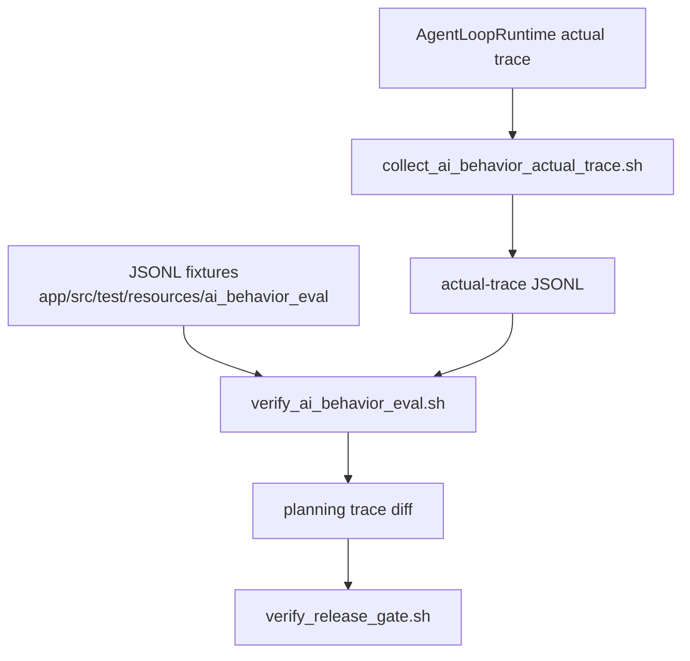

# AI Behavior Evaluation

This page defines behavior evidence for Solin routing, privacy, tool planning,
and fail-closed execution. The implementation owners are in
[the core-module reference](agent_core_modules.md); device and model-task evidence
belongs in [phone acceptance](phone_acceptance.md).

## Choose The Evidence Level

| Level | What it checks | What it does not prove |
| --- | --- | --- |
| Fixture and boundary validation | JSONL schema, tool names, privacy/confirmation/risk expectations, required categories and MVP/boundary coverage | That the runtime produced those outcomes, that a model planned correctly, or that an Android action worked |
| Runtime actual trace | The deterministic `AgentLoopRuntime` fixture harness produced trace rows matching expectations and current source/fixture metadata | Real model accuracy, real-app compatibility, or physical-device behavior |
| Device and phone-task evaluation | Actual provider/action outcomes, UI transitions, valid-model tasks and safety stops on a named APK/device | Production signing, legal/privacy approval, complete API/OEM coverage, or release-owner sign-off |

At main `cb7e4918`, CI [run 41699276903](https://github.com/William-zgx/solin-android/actions/runs/41699276903)
passed the first level: **40 cases, 7 categories, 6 MVP scenarios**. This is a dated
fixture result, not a permanent count or public-strict runtime-trace claim. Current
release status and missing evidence are in [release readiness](release_readiness.md).

## Evidence Flow



## Fixture Contract

Each case has a stable ASCII `id`, expected tools, confirmation class, risk and
privacy levels, routing expectations, owner, MVP scenario, and allowed failure
modes. The seven categories are:

| Category | Boundary |
| --- | --- |
| `memory_recall` | Local memory use and forget/clear behavior |
| `planner_false_positive` | Requests that should remain chat or produce no action |
| `tool_sequence` | Tool ordering and authorization |
| `ocr_noise` | Noisy screen/OCR data cannot weaken target grounding |
| `runtime_failure` | Permission denial, unchanged pages, and explicit failed outcomes |
| `privacy_boundary` | LocalOnly data, eligible remote sends, public evidence and mixed-batch rejection |
| `restart_recovery` | Restored confirmations, external waits, and private state that must fail closed |

`allowedFailureModes` support local/debug diagnosis. Public release verification
rejects unresolved allowed failures. Do not edit a fixture expectation merely to
make an unsafe trace match; the implemented policy, owner documentation, and
regression tests must agree.

## Runtime Trace Contract

Strict release evidence must use trace rows from `agent_loop_runtime`, collected
by `scripts/collect_ai_behavior_actual_trace.sh`. That script runs
`AiBehaviorActualTraceGeneratorTest` on the JVM; the name “actual trace” does not
mean it called a live model or controlled a phone.

The trace and verifier bind:

- Current fixture directory, capability matrix, and action-model/profile SHA-256.
- UTC `recordedAt` within the configured age limit.
- Exactly one row per known fixture id, without unknown or duplicate ids.
- Actual tool, confirmation, risk/privacy, routing path, trace source, and explicit
  fail-closed failure mode where required.
- Placement expectations and reconciliation when required by the boundary map.

Public release requires zero missing/extra rows, zero mismatches, and zero
unresolved allowed failures. Remote-confirmation cases remain `RemoteEligible`;
private evidence cannot be relabeled to satisfy a remote path. Refreshing hashes
alone does not recreate a trace or approve it.

## Commands

Validate fixtures without a device or model:

```bash
scripts/verify_ai_behavior_eval.sh \
  --require-boundary-map \
  --report build/verification/ai-behavior-eval/ai-behavior-eval.properties
```

Collect a deterministic runtime trace and compare it with current fixtures:

```bash
scripts/collect_ai_behavior_actual_trace.sh
# Public-style collection also rejects unresolved allowed failures.
PUBLIC_RELEASE_CONTEXT=1 scripts/collect_ai_behavior_actual_trace.sh
```

Verify an existing trace strictly:

```bash
scripts/verify_ai_behavior_eval.sh \
  --require-boundary-map \
  --actual-trace <actual-trace.jsonl> \
  --require-actual-trace \
  --require-runtime-trace-source \
  --require-agent-loop-runtime-trace-source \
  --require-placement-reconciliation \
  --reject-allowed-failures
```

The collector defaults to `build/verification/ai-behavior-actual-trace/`, including
trace JSONL, planning diff, evaluation report, and collection report. Preserve
those files and matching hashes when referencing evidence. Public artifact,
signing, performance and approval requirements are separate; use
[the release checklist](release_checklist.md#release-gate) for the final gate.

## Boundaries That Need Separate Tests

- Public evidence batches are eligible only if every tool is public, read-only,
  no-confirmation, no-private-output, and has no permission, navigation, scheduling,
  notification, sharing, or other side effects.
- Default critical-only and per-step confirmation are distinct modes. Critical
  controls stay user-operated; private-read-derived network/text steps and the
  first remote-GUI screenshot authorization retain their own confirmation rules.
- Phone composites require authorization for each child, bounded work, and
  explicit partial/unknown outcomes. `ui_collect` success does not prove the whole
  list is complete; `ui_find` must not activate its result.
- Verified route reuse is session-scoped, has no inherited approval, and must stop
  on stale, ambiguous, sensitive, or changed evidence. It proposes normal tools;
  it is not a separate execution path.
- An expired or unrecoverable background binding must not switch to the user's
  main display. Background remote vision and main-screen OCR remain unavailable.
  Foreground guard tests do not replace background negative-path device tests.
- Private tool results, screen/OCR data, memory, attachments and device context
  remain `LocalOnly`. Fixture/runtime evidence must not publish real private
  prompts, credentials, screenshots or tool payloads.

These boundaries have dedicated unit and device tests outside the 40-case fixture
set. A passing fixture count must not be presented as coverage of every new phone
capability. Full model-driven tasks, physical/OEM behavior, paired benchmarks,
and release approvals retain their own evidence requirements.
