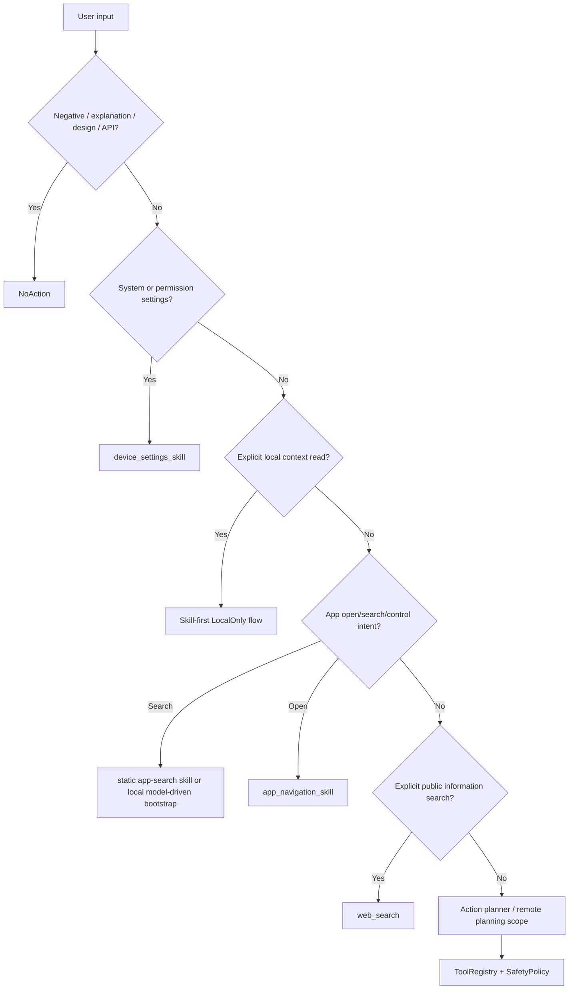

# Intent Routing / Skill Arbitration

核对基线：2026-11-04，主分支 `cb7e4918`。本页描述意图路由，不重复模型位置决策；
Local/Auto/Remote 的实际运行位置见 [自适应推理状态](specs/20260718-adaptive-edge-inference/status.md)。
确认规则归 [Safety and audit](agent_core_modules.md#safety-and-audit) 所有，屏幕外发归
[隐私说明](privacy_notice.md#remote-vision-gui-automation-opt-in) 所有。

## 目标

路由层只回答一个问题：这句话是否已经足够明确，可以安全地进入某个
Skill/tool 边界？

原则是“明确动作优先、风险边界优先、误触发最小化”。没有明确动作意图时，
必须保持 `NoAction`，让聊天回答处理解释、讨论、否定、设计和 API 问题。

## 当前决策流

## 优先级矩阵

| 输入类型 | 示例 | 期望路径 | 边界 |
| --- | --- | --- | --- |
| 否定、解释、设计讨论 | `解释 Wi-Fi`、`不要打开 Wi-Fi`、`Wi-Fi 设置页面怎么设计` | `NoAction` | 不进入 Skill，不生成工具草稿。 |
| 系统 Wi-Fi 设置动作 | `打开WiFi`、`打开 WiFi`、`打开 Wi-Fi` | `device_settings_skill` / `open_wifi_settings` | 系统设置优先于同名 App。 |
| 其他系统/权限设置动作 | `打开无障碍设置`、`打开 Usage Access` | `device_settings_skill` / 对应 settings tool | 按当前策略授权打开页面；特殊访问仍由用户在系统界面授予，不当作普通 runtime permission。 |
| 明确命名 App 打开 | `打开名为 WiFi 的 App` | App navigation 层 | 不能误触系统 Wi-Fi 设置。 |
| App 内搜索 | `打开淘宝搜索耳机`、`在当前应用搜索耳机` | Static app-search skill；有已校验本地动作规划模型时走 model-driven bootstrap | V1 只做低风险搜索闭环；默认本地 replanning 的 observation 只给本地动作规划模型；显式开启远程视觉并通过本次运行确认后，可由远程视觉先处理新鲜截图和可见控件文字；不发送、删除、支付、下单、授权或发布。 |
| 普通 App 打开 | `打开淘宝` | App navigation 层 | 不接受任意 Intent、Activity、extras 或未白名单 deep target。 |
| App 打开 + 应用内后续 | `打开淘宝并搜索耳机` | App navigation 层；具备本地动作规划能力或已显式开启远程视觉时可继续 observe→replan | `followUpIntent` 是 schema 受限的意图字符串，不能携带任意 Intent/Activity/extra；后续仍受目标包、当前授权、步数预算和实时危险控件守卫约束。 |
| 本地私密读取 | `总结剪贴板`、`读取当前屏幕文字` | Skill-first LocalOnly flow | 按当前确认策略执行；结果不得进入远程 continuation，系统权限仍须用户授予。 |
| 公开信息检索 | `查一下今天杭州天气`、`搜索 Rust 最新版本` | `web_search` | 只做 public evidence；个人信息或疑似 secret 查询回到确认/保护路径。 |

## 模块职责

- Skill-first parser：只处理边界清楚、参数可本地保守提取的请求。
- Action planner：作为兼容和补充，不应覆盖明确的系统设置、权限设置、
  LocalOnly 读取或 App navigation Skill。
- App 搜索：默认使用静态 Skill；当本地动作规划模型已校验时，Skill 只负责
  打开/等待/首次观察，之后默认本地 replanning 每轮只允许本地模型规划一个低风险 UI tool。
  显式开启的远程视觉路径优先于本地 replanner，可返回受预算约束的多步计划。
  模型可用的 UI 词汇现包含有界的 swipe（滑动）、long-press（长按）与白名单系统
  按键（home/recents/enter/delete），ToolSpec 保留 Medium-risk/Required 元数据；是否弹窗由
  当前确认模式及 critical reason 决定，仍计入相应预算并保持不发送/不支付/不发布边界。
- 组合工具只在用户明确要求及完整 LocalOnly 页面证据满足条件时进入规划范围，一次最多
  暴露一个 `ui_collect`、`ui_find` 或 `ui_set_wheel`。屏幕文字不能替用户选择能力；
  子步骤各自授权，查找不自动点击。见 [Mika 合同](plans/mika-phone-capabilities.md)。
- 远程视觉是独立 opt-in 规划路径，不把私密读屏工具加入 remote tool schema。必须在
  两种确认模式中都取得本次 run 的首个确认，且后台屏幕作用域禁用此路径。
- Remote planning scope：只暴露 remote-safe planning specs；本地私密 evidence
  工具不进入远程工具列表。
- `ToolRegistry`：最终确认 tool 是否存在、参数是否合法、risk/permission/tag
  是否满足执行边界。
- `SafetyPolicy` 给出基础允许/确认/拒绝结论，`ConfirmationBypassPolicy` 结合运行状态、
  用户原话、私密读取历史和确认模式决定可否自动执行；拒绝不能被绕过。

## Resolver Evidence 策略

`UiTargetResolver.explain()` 用于 App 内搜索/control 的成功进度与失败诊断，包括
`input_ready`、`observed_entry` 等会进入本地 observation-replanning prompt 的信号；它不替代实际
Accessibility 执行路径。

Debug eval receiver 可以把这些字段写入 tap/type/submit 的 request result：

- ranked candidates
- label
- bounds
- clickable/editable
- profile hint
- score components
- selected node
- failure kind

正式 tool result schema 暂不扩大；用户侧只看到安全摘要。

## 验证合同

以下是证据要求，不是宣称存在同名 DTO 的类型清单：

- 路由证据：Skill-first、ActionPlanner、remote planning 的命中路径、拒绝原因和确认策略。
- Resolver 证据：候选排名、命中节点、分数构成和失败类型。
- 行为夹具：输入、期望工具、确认策略、risk、LocalOnly/RemoteEligible 和允许失败模式。
- 设备 artifact：serial、API、ABI、test count、failedTarget、reason，以及 instrumentation/logcat 路径与 SHA-256。
- 模型能力：由当前模型 profile 和 `ModelCapabilityProfile` 支持的能力校验驱动，不能仅凭模型显示名称认定支持 chat、vision、embedding 或 action。

脚本层 artifact 仍落到 `device-verification.properties`，并绑定
instrumentation/logcat SHA。Release validation verifier 必须用这些 SHA 证明
报告内容真实存在，而不是只填路径。
