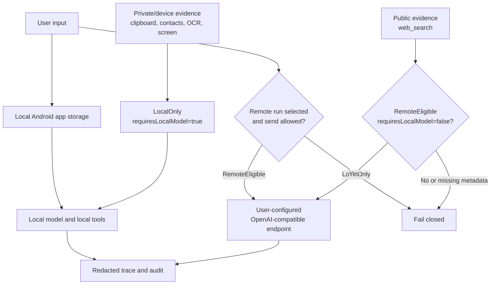

# Privacy Notice

This notice describes the privacy boundary implemented by `栖知 Solin` for
Android release candidates. It is not a publication approval: public
distribution still requires release, security, legal, store-policy, and support
owner review for the exact build and channel.

## Boundary Summary

Solin is local-first. Conversation data, local model state, memory,
background tasks, Agent traces, pending confirmations, Skill checkpoints, and
tool audit metadata are stored in local Android app storage unless a specific
remote or Android system boundary below is crossed.

`LocalOnly` means the app must keep the content on device and route any
continuation through a local model. `RemoteEligible` means the content may be
sent only after remote-mode gates and confirmations pass. Missing or ambiguous
privacy metadata fails closed.

## Local Storage

Local records may include user-entered chat text and assistant responses.
Privacy-sensitive generated or tool-derived content is marked `LocalOnly`
where the code can identify it. Examples include clipboard-derived messages,
shared-input excerpts, OCR excerpts, current-screen Accessibility text,
local memory-control status turns, and local action turns.

If a chat message is created without an explicit privacy value, the
`ChatMessage` domain model defaults that message to `RemoteEligible`. The
database column default is `LocalOnly`, but the persistence layer always
writes the domain model's value, so the effective default for newly created
messages is `RemoteEligible`. Code paths that handle privacy-sensitive
content (clipboard, OCR, Accessibility screen text, shared-input excerpts,
local action turns) explicitly set `LocalOnly`. These local records are not
a cloud sync source in this codebase.

Remote model API keys and Hugging Face read tokens are stored separately in
Android Keystore-backed encrypted preferences. Clearing the relevant field
removes the stored secret.

The Android manifest sets `allowBackup=false`, so this codebase does not opt
local app storage into Android cloud backup or app-data sync.

### Evidence Encryption

On-device evidence blobs are encrypted at rest using AES/GCM/NoPadding
(authenticated encryption). The encryption key is stored in AndroidKeyStore
under the alias `solin_evidence_aes_gcm_v1`. Each blob has a random 12-byte
GCM nonce inside a versioned envelope, followed by ciphertext and its 16-byte
authentication tag. Legacy plaintext and AES/CBC/PKCS5Padding blobs (key alias
`solin_evidence_key`) are read only after validation against the content address,
and migrate to GCM on a successful read. Production fails closed when keys are
unavailable or evidence cannot be authenticated; it does not fall back to writing
plaintext. Evidence metadata records the envelope and encrypted state; the
no-context plaintext store is for JVM tests.

## Remote Model Mode

Remote model mode sends requests only after the user-configured
OpenAI-compatible chat endpoint exists and the run is bound to Remote: either the
user selected Remote, or explicitly selected Auto and the on-device placement
policy chose an eligible remote candidate. The current debug and release-like
builds expose Auto as opt-in; availability in a build is not release approval. Solin accepts a service root, `/v1` base URL, or full chat endpoint and
normalizes it to the matching OpenAI-compatible `/v1/chat/completions` request
path when needed. "OpenAI-compatible" means the request and response shape; it
does not imply OpenAI operates the endpoint.

A remote request can include the current user prompt, selected model name,
generation parameters, and prior chat messages whose privacy is
`RemoteEligible`. The app filters `LocalOnly` messages from remote history and
rejects a `LocalOnly` current prompt before making a remote request. Local
memory hits, device context, clipboard content, OCR text, current-screen
Accessibility text, shared-input excerpts, attachment metadata, and local
action draft turns are not automatically sent to a remote model. If the user
manually types or pastes the same content into a normal remote-eligible
message, that new message can be sent. Current-screen screenshots are the one
exception, and only under the explicit opt-in described in "Remote-Vision GUI
Automation" below.

### Cloud/Edge Router (opt-in)

With the Trust-Center "云端路由" setting in Shadow or Active and the Auto
inference preference, Solin may send the text of one chat request to the Codiv
decision model (`https://api.codiv.ai/v1/systemone`, model `openjev-0.1`) to ask
whether the on-device model can answer it. This happens only after the on-device
rules found both the local and the configured remote model eligible and chose
between them by request complexity, so `LocalOnly` content, images, and requests
that must stay local are never sent. The request carries the text (capped at
2,000 characters) and a fixed question; never history, memory, attachments,
device context, or tool results. Text that looks like personal or secret data
is not sent. In Shadow the request is sent in the background and only counted;
the reply does not wait for it and its answer is never applied. The Codiv API
key is entered by the user, stored encrypted on the
device, and sent only to Codiv. Each send records a redacted remote-send audit
entry without the text. Codiv's logging and retention policies apply. The
setting is off by default, and clearing the key turns it off.

Remote send reminders are policy-controlled for ordinary text. User-provided
images and suspected sensitive content are stricter: they require per-send
confirmation before they can leave the phone. Image bytes are attached as
OpenAI-compatible `image_url` content parts only when image input is enabled,
the selected remote profile declares vision support, the endpoint/model
supports that message shape, and the user confirms the send. If the endpoint
rejects image content, Solin reports image-input failure and does not
fall back to OCR.

Remote transport requires HTTPS by default. The network security config
enforces HTTPS for all remote traffic; cleartext is only permitted for
loopback addresses (`localhost`, `127.0.0.1`, `10.0.2.2`, `::1`).
See `res/xml/network_security_config.xml`. When an API
key is configured, the runtime sends it as an authorization credential to the
configured endpoint. The endpoint operator's logging and retention policies
apply.

Local vision is separate from remote vision. A verified local chat model whose
profile declares vision support can process user-provided image bytes on
device, within the app's bounded size/count limits. Unsupported local vision
paths fail closed instead of implicitly OCRing or uploading the image.

## Tool And Device Context Boundary

Remote model tool requests are not executed by the remote endpoint. The app
parses OpenAI-compatible `tool_calls` locally and revalidates every request
through the Tool Registry, safety policy, Agent trace, and audit path before
execution.

Remote mode can expose public search plus non-private draft, navigation,
sharing, or local reminder-style planning schemas. Those action schemas are
validated and executed locally, not by the remote endpoint, and still require
local confirmation when their risk policy requires it. Private local evidence
tools that read clipboard, contacts, calendar, files, notifications, screen
text, OCR, or other device context are not exposed to remote planning. A public
read-only evidence tool such as `web_search` may run without confirmation for
public queries; queries that appear to contain personal data or secrets, or
network steps following a private read in the same run, require confirmation
before network access. Text handed to another app — a system share
(`share_text`), an email / SMS / calendar / contact draft — is also treated as
egress: in the default critical-only mode it is confirmed when the text looks
personal or secret, or when it was composed after a read of private device data
and is not the user's own wording. A draft built only from the user's words can
be auto-approved if non-sensitive and free of other critical reasons. Sensitive
user-supplied text still requires confirmation.

Multiple tool calls in one remote model turn may run concurrently only when
every requested tool is public/read-only, requires no confirmation, has no
private output keys, and declares no Android permission, MediaProjection,
external-navigation, sharing, scheduling, notification, or other side-effect
permission. Mixed batches are rejected as a whole before any tool runs. A
public evidence result can return to the remote model only when it explicitly
declares `privacy=RemoteEligible` and `requiresLocalModel=false`.

Device context and phone-control tools pass Agent planning, schema validation,
safety policy and the current confirmation policy. Default critical-only mode
may run reversible steps without a prompt; a per-step mode is also available.
Critical reasons and system permission/consent flows are not waived. Current local evidence
includes bounded reads for clipboard text, calendar busy/free windows, contact
name/phone search, foreground-app estimates, notification summaries, recent
file metadata, screenshot/image OCR excerpts, current-screen Accessibility
snapshots, and low-risk Accessibility actions such as tap, type, submit search,
scroll, swipe, long-press, whitelisted system-key presses
(home/recents/enter/delete, never an arbitrary keycode), back, and wait. These
private results are `LocalOnly` and
`requiresLocalModel=true`.

Android runtime permissions and special-access flows remain explicit user
choices and are not silently granted by tool auto-approval. Permission denial is
a structured tool failure, not an automatic retry. Usage Access supports bounded
foreground-app estimates. Accessibility supports current-screen reads, low-risk
phone-control gestures, and — when the opt-in
Remote-vision GUI automation control is enabled — direct screen capture via the
already-connected Accessibility service (`AccessibilityService.takeScreenshot`),
whose pixels are transmitted to the remote vision model (see "Remote-Vision GUI
Automation" below). MediaProjection is used only for one-shot current-screen
screenshot OCR after foreground consent (a separate, LocalOnly path). While that
single capture runs, Android requires a short-lived `mediaProjection`
foreground service; Solin shows it as a visible "Solin正在读取当前屏幕"
notification, starts it only after the user granted MediaProjection consent,
and stops it as soon as the capture finishes, fails, or is cancelled (it
self-stops after 45 seconds otherwise). The service captures nothing itself
and transmits nothing. If the service cannot start, the OCR tool reports a
distinct failure instead of capturing or asking again.

For screen understanding specifically, screen pixels, OCR excerpts,
Accessibility text, Accessibility snapshot nodes/bounds metadata, and
post-action structured observations and verification summaries stay
`LocalOnly` by default. They are not automatically included in remote history,
sent to a remote endpoint, or sent to a remote VLM.
The same content may leave the device only if the user manually creates a
separate `RemoteEligible` message containing it, **or** if the user has
explicitly enabled the opt-in "Remote-vision GUI automation" control described
below and confirmed the run's first action.
Current-screen screenshot OCR may return a fused LocalOnly screen observation
that combines OCR text/bounds with transient Accessibility nodes/bounds; it
does not persist screenshots, pixels, URI/path metadata, or window titles.
Text-only OCR and screen evidence cannot directly bypass target validation for
tap/type actions. When a post-action page-change check fails or the action
target cannot be grounded, phone control fails closed or asks for a new
confirmation instead of converting private screen evidence into `web_search`,
external sends, or other outbound actions.

### Remote-Vision GUI Automation (opt-in)

Solin also offers an **opt-in** mode in which a remote vision model plans
in-app taps by looking at screenshots of the current screen. This is off by
default. When the user turns on the "Remote-vision GUI automation" toggle in
the Trust Center **and** the configured remote model declares vision support
**and** the app is in Remote mode, the in-app observe→plan→tap loop may capture
the current screen and **transmit** those pixels, together with the text of the
visible on-screen controls, to the user-configured remote vision endpoint so the
model can plan the next steps. Password fields are never included.

This is a deliberate, disclosed reversal of the default screen-pixel boundary,
gated by defense-in-depth:

- **Informed consent:** the pixels leave only after the user enables the
  Trust-Center opt-in (which carries an explicit egress warning). Capture uses
  the already-connected, user-granted Accessibility service
  (`AccessibilityService.takeScreenshot`); there is no separate per-capture
  system screen-cast dialog. Egress is instead governed by this opt-in plus the
  run gate below.
- **Run gate:** the user must first confirm one in-app action of the run (the
  initial observe or the app launch) before any screenshot of that run is sent.
  This holds in both confirmation modes. Critical-only mode usually prompts for
  nothing, so Solin raises that run's first in-app step to a confirmation; the
  opt-in toggle alone is not a per-run approval. With per-step confirmation on,
  that confirmation is the normal step prompt. A run that never gets a
  confirmation sends no screenshot and falls back to the local action model
  (or stops when there is none). Captures are bounded by a per-run step limit,
  and a new run starts over.
- **Transmitted, not persisted:** the compacted JPEG and control list are sent
  for a single request and then dropped; they are never written to local
  records, audit, or receipts.
- **What each request carries:** the screenshot, the control list, the public UI notes of the
  foreground app (short reference facts about that app's on-screen layout, capped at 300
  characters — these describe public app UI and contain no user data), the user's request, and
  the kinds of action the model already had executed in this run (with tap coordinates, never
  typed text or results). No chat history, memory, or other tool results.
- **Protected screens:** the control list is read only after a capture succeeds.
  A failed or fully blank capture (the system blacks out secure windows) sends
  nothing. A secure surface covering only part of an otherwise normal screen is
  not detected, so its accessibility text can be included.
- **This is NOT the remote tool-planning path:** the remote model receives the
  content above plus a decision prompt, not device-control tool schemas, and never
  executes anything. Its reply is an untrusted tap / back / scroll / type /
  submit / wait / stop suggestion (or a short plan of them) parsed into local
  `ui_*` actions or `finish`; later plan steps run only while each step before
  them succeeds. A stop, or a repeated action on a screen that did not change, ends
  the run. Every tap runs locally through the same device-control
  preflights (dangerous-action and foreground-package checks) and confirmation
  policy as any other phone-control action. The agent stops before activating
  payment/send/delete/publish/order/transfer/authorization controls; the user must
  tap them. Confirming a step does not authorize the agent to tap those controls.
- **Egress audit:** each send records a redacted remote-send audit
  event (decision, model name, image count, summary) — never the pixels or the
  prompt — so the user can review every screenshot that left the device in the
  Trust Center's remote-send log. Planned steps that need no new capture send
  nothing and add no entry.
- **Fail closed:** if the opt-in is off, the model is not vision-capable, the
  mode is not Remote, the Accessibility service is not connected, or the screen
  cannot be captured, no pixels leave and the loop stops (or falls back to the
  local action model where available).

### MCP Extension Tools (opt-in)

Solin can use tools provided by other installed apps over the Model Context
Protocol (MCP). This capability is **off by default** and is controlled by the
"MCP 扩展工具" switch in the Trust Center.

- Turning it on the first time requires accepting a disclosure: tool arguments
  (which may contain conversation content) leave Solin for the MCP server app,
  which may upload them, so every MCP call is treated as data leaving the
  device. Turning it off takes effect immediately; turning it on, or newly
  approved tools, take effect after the app restarts.
- Only servers the user registered and tools the user approved are exposed.
  Solin binds a server only if its app holds Solin's `MCP_SERVER` signature
  permission (same signing certificate), accepts replies only from that app's
  UID, and refuses a call if the server's live tool schema no longer matches
  the schema the user approved. Tools whose schema is outside Solin's closed
  argument schema are not exposed. MCP tools are never offered to remote-model
  planning.
- Every MCP tool is `HighExternalSend` risk with confirmation `Required`, so
  each call is confirmed individually and cannot be skipped by the
  reduced-confirmation setting.
- Each attempted call is recorded in the remote-send audit as
  `MCP:<server>` with the tool name and the number of arguments only — never
  argument values, the user's prompt, or the result.
- MCP results are `LocalOnly` and `requiresLocalModel=true` by default, are
  handled only by the local model, and binary content (images, blobs) is
  dropped. Results become `RemoteEligible` only for a server the user
  explicitly marked as public.

## Bounded Phone Operations And Experimental Background Display

Multi-screen collection, scrolling to find a target, and number-wheel adjustment
use the existing local observation and action tools. Each child operation is
reauthorized; a parent approval never grants its children permission. Collected
text and target evidence remain `LocalOnly`, with no automatic OCR or upload.
Limited collection reports partial coverage rather than claiming the full page
or task was read. Input verification reads back the same safe field after one
write; it does not retain passwords or repeat an uncertain write.

Verified search routes are held only in process memory for the same conversation
and exact request. They retain salted evidence digests and argument positions,
not raw screen text, screenshots, or user input. Clearing conversation history or
closing the runtime clears them. A prior route never carries prior consent.

Debug builds additionally offer an explicitly provisioned background-display
experiment. It requires already-authorized ADB and a user-enabled session, expires
after 15 minutes, and exposes only a restricted local display protocol. The
helper has no arbitrary shell, input-injection, unlocking, or permission-granting
API. Input still passes the app's live action guard on that display. Its
credentials are provisioned through authorized ADB into app-private storage and
consumed once. The helper listens only on `127.0.0.1` at a random port. Mutual
HMAC challenges authenticate possession of the provisioned key without sending
that key over TCP; authenticated frames bind direction, session nonces, and a
monotonic sequence number. No externally reachable listener is opened. Background run identifiers may be retained
locally without task content so a restarted app can refuse an unrecoverable
background binding instead of acting on the main screen.

The background display is not enabled by default. An expired, stopped, or
unrecoverable bound session fails closed. Remote vision and main-screen
MediaProjection OCR are unavailable inside a background control scope: evidence
from the user's main screen must never be substituted for the task display.
Background frame buffers are local and transient; secure-display protections are
not disabled. Device/OEM compatibility remains experimental; see
[the capability record](plans/mika-phone-capabilities.md).

## External Intents And Attachments

Confirmed tools may open Android system screens, the share sheet, email drafts,
calendar drafts, contact drafts, web links, app launchers, the camera, or
allowlisted app settings pages. Once an external screen opens, the destination
app or Android system component may receive the prefilled data needed for that
action. Share sheets, drafts, high-risk actions, and unknown external actions
remain an opened-but-unverified boundary until the user records the outcome.

System speech recognition inserts a transcript into the compose box only;
sending remains explicit. Voice input prefers Android's on-device recognizer
(`SpeechRecognizer.createOnDeviceSpeechRecognizer`, Android 12+) when the
device reports one, in which case audio is recognized on the device. Otherwise
Solin uses the default system recognition service and requests offline
recognition (`EXTRA_PREFER_OFFLINE`); because that request is only a hint, the
system recognition service may still use its own online service, so Solin
shows the voice consent again with an explicit online-recognition note before
the first such session. Solin itself does not upload or store the audio. Audio/video/legacy Office/binary attachments are
metadata-only in the current app. Supported strict UTF-8 text, RTF, PDF text
layers, PDF scanned-page OCR fallback, and Office Open XML attachments may
produce bounded local excerpts. Shared-input excerpts are staged as local
composer drafts and are not sent to generation until the user taps send.

Images are not written into text prompts, chat history, audit, or receipts.
They enter model requests only as bounded image bytes on a verified local
vision path, as confirmed remote vision content parts on a configured remote
vision path, or — when the opt-in Remote-vision GUI automation control is
enabled — as transient current-screen screenshots captured by the in-app
automation loop and transmitted to the remote vision model to plan a tap (see
"Remote-Vision GUI Automation"). Non-image attachments, shared text, text
excerpts, and OCR excerpts are not read or sent on the remote image path.
Explicit confirmed OCR tools remain separate.

## Model Downloads And Tokens

Recommended model downloads use Android `DownloadManager` and contact the
configured upstream download URLs. Recommended downloads are registered only
after SHA-256 verification against the pinned model manifest. Custom imported
models and custom URL downloads are user-supplied and are not covered by the
recommended-model provenance guarantees.

The Hugging Face read token saved in the app is used only to prepare and
download gated model assets that require Hugging Face authorization. It does
not approve model licensing, redistribution, or publication. Build-time tokens
such as `SOLIN_HF_TOKEN` belong to internal packaging flows and must not
be committed, logged, or placed in reports.

The recommended local chat path currently starts with the E2B model, which is a
multi-GB download. Users can instead configure a remote model endpoint or
import a trusted compatible `.litertlm` file. Smaller memory and action model
assets are not replacements for a chat model. Local chat model profiles use an
8k-token context window with a 6k input budget and 2k output reserve; the
window is read from the model capability profile (8k is the fail-safe default
when a profile declares none, and larger declarations are capped at 32k). That
is a runtime prompt budget, not an authorization token.

Model files are stored in local app storage and are not bundled into the
ordinary Play/public APK. The separate internal `bundledModels`
quick-experience package can include model bytes in same-signature install-time
split APKs for lab validation, but that package is not the public release
artifact.
Network operators and model hosts may receive normal download metadata such as
IP address, URL, user agent, timing, and download size.

## Audit, Retention, And Controls

Tool audit events store metadata such as event time, event type, tool name,
status, risk level, permission names, and sanitized summaries. They are not a
full prompt or tool-argument log. The app prunes the Room-backed audit table
after writes and keeps only the most recent 500 audit events.

### Audit Privacy

`RemoteSendAuditEvent` does NOT contain the raw user prompt.
`RemoteSendAuditRepository.record()` never persists raw prompts. Audit records
contain: timestamp, send decision, model name, sensitive safety categories,
image count, remote history message count, and a redacted summary (capped at
200 characters) — never message content, token counts, privacy level, or
error codes.

Remote chat, remote vision, the cloud/edge decision router, MCP extension tools
and each `web_search` request write these entries. This is not a complete network
traffic log: model downloads and Android external intents have separate handling,
and maps/deep-link intents do not currently produce an equivalent remote-send
entry. A `web_search` entry records the tool name, the provider host, and the
query length only — never the query text or the request URL (which carries it).

Agent trace and pending confirmation recovery are narrower than a full
execution replay. Pending rows persist only allowlisted request arguments,
redacted structure, and value-free checkpoint identifiers where possible.
Payload-bearing confirmations fail closed after restart instead of restoring
private executable payload values.

Users can create, switch, and delete chat sessions. Long-term memory supports
reviewing explicit records, forgetting individual records, and clearing
explicit memory records. Clearing app data or uninstalling the app removes
local app storage according to Android platform behavior. When local memory is
disabled, explicit remember/fact commands do not create new long-term memory
records; forget and clear controls can still remove existing records.

This codebase does not contain a first-party analytics upload path. Disclosed
outbound boundaries include configured remote chat/vision, the optional decision
router, public web search, model downloads, policy-authorized Android external
intents and confirmed calls to user-approved MCP server apps. Those services may
apply their own logging and retention policies. Recheck the exact release build
and any added SDKs before publishing this statement externally.
The device resource entry displays only locally sampled aggregate app PSS,
heap, available RAM, CPU, and thermal pressure state. It does not include
prompts, files, images, tool parameters, API keys, or remote responses, and it
is not uploaded as analytics.
